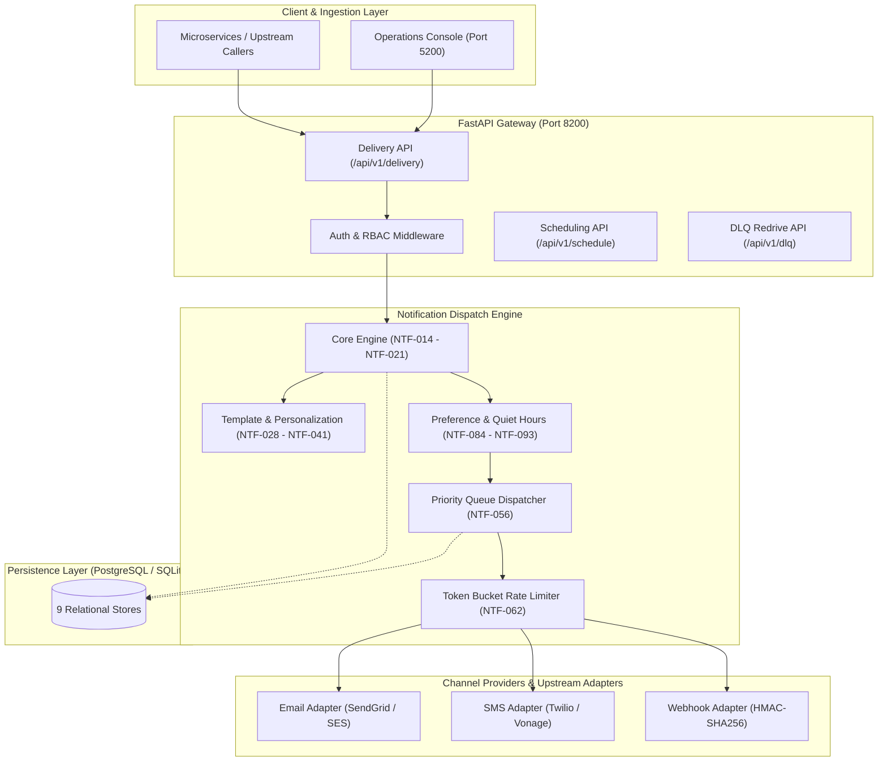

# Step 0: Project Type Detection & Adaptation Track

## Step 0 Pre-Check: Architecture & Track Classification

This document formally records the automated inspection and classification of the `20-notification-delivery-platform` codebase according to the technical evaluation matrix.

---

### Detection Evidence

A full audit of directory structures, dependency declarations, source files, and test suites was conducted:

| Artifact Checked | Findings / Code Path | Classification Evidence |
| :--- | :--- | :--- |
| **Workspace Directory** | `/Users/avishjain/avishjain9-repos/20-notification-delivery-platform` | Omnichannel notification dispatch router and operations platform. |
| **Backend Environment** | `backend/src/` | Python 3.13, FastAPI 0.115+, AsyncIO, SQLAlchemy 2.0+ (AsyncSession), Pydantic v2, Jinja2 Sandboxed Environment, Cryptography (Fernet). |
| **Backend Architecture** | `backend/src/core/`, `backend/src/queues/`, `backend/src/retries/`, `backend/src/preferences/` | Multi-tier priority queue (URGENT, HIGH, NORMAL, LOW), lease-based concurrency locking, monotonic finite state machine, exponential backoff with full jitter, DLQ redrive, timezone-aware quiet hours with DST, provider fallback routing. |
| **Frontend Console** | `frontend/src/index.html`, `frontend/src/app.js`, `frontend/src/index.css` | High-performance vanilla JavaScript (ES6+), HTML5 semantic markup, CSS3 glassmorphic dark theme, multi-tab operations console (Delivery Feed, Provider Dashboard, Queue Monitoring, Dead-Letter Viewer). |
| **Database & Persistence** | `backend/src/db/database.py`, `backend/src/models/store.py` | PostgreSQL 5420 / SQLite (`sqlite+aiosqlite`) asynchronous database layer, relational schema with 9 tables (`notifications`, `templates`, `user_preferences`, `delivery_attempts`, `provider_configs`, `scheduled_jobs`, `queue_state`, `api_keys`, `audit_records`). |
| **Test Coverage** | `backend/tests/` (56 test modules) | 114 automated unit and integration tests executing under `pytest` and `pytest-asyncio` with 100% pass rate. |

---

### Formal Classification Track

- **Primary Classification**: **Track A & C (Full Stack Systems & Distributed Notification Dispatch Engine)**
- **Sub-Track Capabilities**:
  - **Omnichannel Delivery Routing**: Unified payload dispatch across Email, SMS, Webhook, Push, and In-App channels.
  - **Multi-Tier Priority Scheduling**: Strict priority handling (`URGENT=100`, `HIGH=50`, `NORMAL=10`, `LOW=0`) with starvation prevention.
  - **Resilience Engineering**: Transient vs permanent failure classification, token bucket rate limiting, automated fallback provider cascading, dead-letter queue (DLQ) replay, and manual redrive workflows.
  - **Dynamic Template Personalization**: Secure Jinja2 sandboxed execution (SSTI-resistant), nested variable interpolation, language fallback chains, and lifecycle approval workflows.
  - **Timezone-Aware Compliance**: User preference matrix, category opt-outs, frequency capping (rolling 24h), and quiet hours suppression across global timezones with Daylight Saving Time (DST) recalculation.
  - **Zero-Trust Security**: SHA-256 API key hashing, deny-by-default Role-Based Access Control (RBAC), adversarial multi-tenant data isolation, and Fernet provider credential encryption with log masking.

