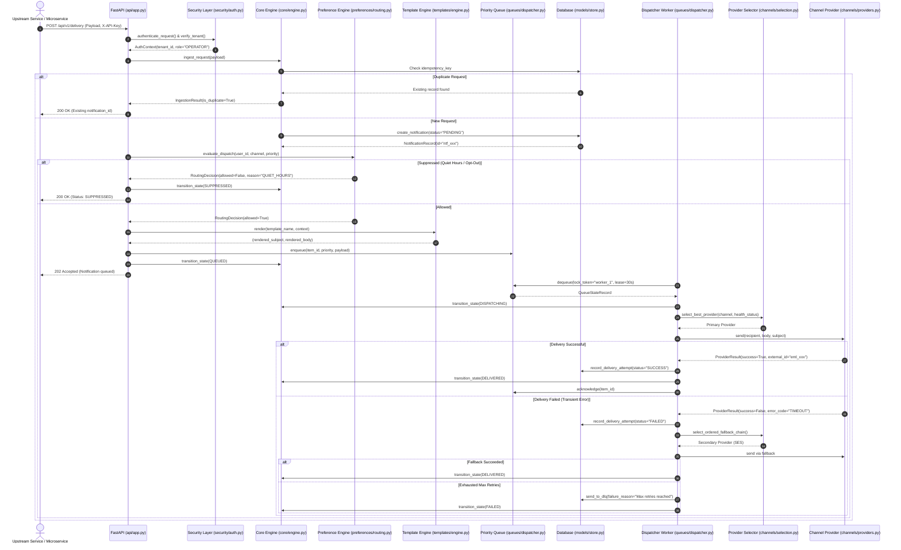
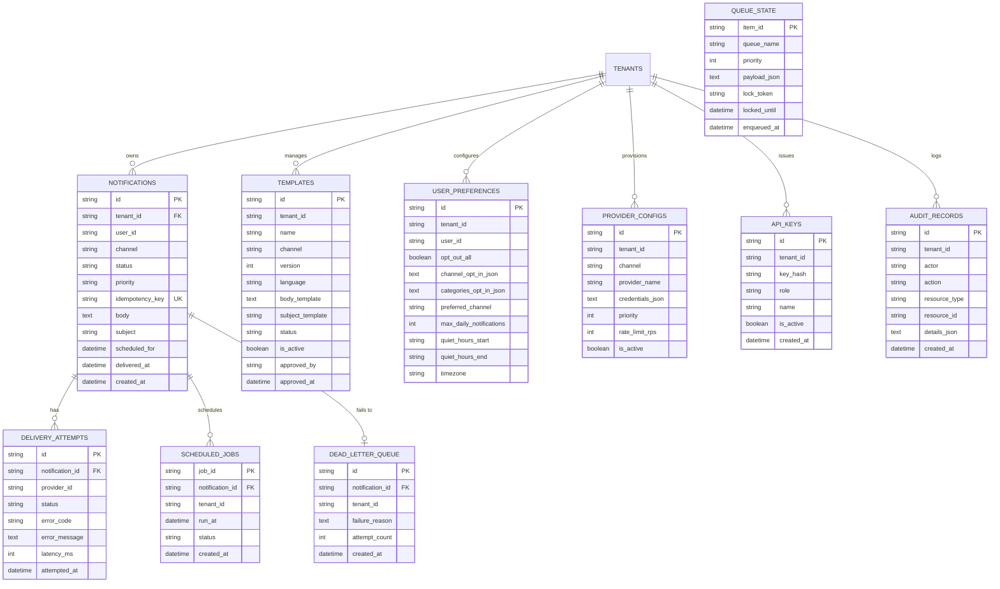

# Step 0: Full Project Analysis & Architectural Trace

## 0.1 What the Project Is

**OmniPost (20-Notification-Delivery-Platform)** is an enterprise-grade, high-throughput omnichannel notification delivery engine and operations platform built using **Python 3.13**, **FastAPI**, **AsyncIO**, **SQLAlchemy 2.0 (AsyncSession)**, and a **Vanilla JS / HTML5 / CSS3** operations console.

### Problem Solved
In enterprise distributed systems, notification delivery is inherently fragile:
1. **Third-Party Volatility**: Downstream provider APIs (SendGrid, Twilio, AWS SES) frequently encounter transient network errors, latency spikes, rate limits, and regional outages.
2. **Channel Starvation**: Mass marketing email blasts or batch digests clog queues, delaying time-critical transactional alerts like two-factor authentication (2FA) OTP codes or fraud alerts.
3. **Template Sprawl & SSTI Vulnerability**: Unvetted string formatting exposes servers to Server-Side Template Injection (SSTI) and inconsistent multilingual rendering.
4. **Regulatory & User Fatigue**: Failing to respect recipient quiet hours across international timezones violates telecom regulations and degrades customer trust.

### Architectural Solution
OmniPost centralizes all outbound messaging across five channels (Email, SMS, Webhook, Push, In-App). It enforces:
- **Strict request idempotency** using `(tenant_id, idempotency_key)` constraints.
- **Multi-tier priority scheduling** where `URGENT` (weight 100) and `HIGH` (weight 50) messages preempt `NORMAL` (weight 10) and `LOW` (weight 0) messages.
- **Lease-based worker concurrency** with row-level locks and starvation protection.
- **Provider capability matching & automatic fallback** when a primary vendor returns retryable 5xx or rate-limit codes.
- **Exponential backoff retries with full jitter** and dead-letter queue (DLQ) manual redrive and replay APIs.
- **Sandboxed template execution** with nested variable interpolation, localization fallback, and administrative approval workflows.
- **Timezone-aware quiet hours** with midnight wrap-around and rolling 24-hour frequency capping.

---

## 0.2 System Architecture & End-to-End Traces

---

## 0.3 Complete API Inventory

### Backend REST Endpoints (Port 8200)

| HTTP Method | Route Path | Auth Required | Handler Function | File & Line | Core Responsibility |
| :--- | :--- | :--- | :--- | :--- | :--- |
| `GET` | `/healthz`, `/health` | None | `healthz()` | `api/app.py:107` | Liveness probe returning service metadata and UTC timestamp. |
| `GET` | `/readyz` | None | `readyz()` | `api/app.py:120` | Readiness probe executing `SELECT 1` against database session. |
| `GET` | `/metrics` | None | `metrics_endpoint()` | `api/app.py:143` | Prometheus text metrics exporter for delivery latency & throughput. |
| `POST` | `/api/v1/delivery` | Optional/Key | `deliver_notification()` | `api/app.py:192` | Core delivery ingestion, validation, preferences, and dispatch. |
| `POST` | `/api/v1/schedule` | Optional/Key | `schedule_notification()` | `api/app.py:319` | Delayed/scheduled job creation with `run_at` UTC timestamp. |
| `GET` | `/api/v1/schedule/due`| None | `get_due_scheduled()` | `api/app.py:340` | Worker polling endpoint retrieving due scheduled notifications. |
| `POST` | `/api/v1/notifications/{id}/retry` | Optional/Key | `retry_notification()` | `api/app.py:371` | Manual retry creating new delivery attempt and audit log. |
| `POST` | `/api/v1/notifications/{id}/replay` | Optional/Key | `replay_notification()` | `api/app.py:398` | Replays failed notification through pipeline with audit tracking. |
| `POST` | `/api/v1/dlq/reprocess` | Optional/Key | `reprocess_dead_letter()`| `api/app.py:424` | Removes item from DLQ, resets state to QUEUED, and re-dispatches. |
| `GET` | `/v1/notifications/{id}` | None | `get_notification_status()`| `api/app.py:454` | Status lookup returning full lifecycle history and delivery attempts. |
| `POST` | `/v1/templates` | Optional/Key | `create_template()` | `api/app.py:481` | Registers new template version with channel and language metadata. |
| `GET` | `/v1/templates/{name}` | None | `get_template()` | `api/app.py:499` | Fetches active template definition for inspection or editing. |
| `GET` | `/v1/notifications` | None | `list_notifications()` | `api/app.py:518` | Paginated query of notifications filtered by tenant and status. |
| `POST` | `/notifications/dispatch` | None | `legacy_dispatch()` | `api/app.py:552` | Direct synchronous dispatch adapter for legacy callers. |
| `GET` | `/api/v1/console/overview` | None | `get_console_overview()` | `api/app.py:578` | Delivers aggregated KPIs (delivered, queued, suppressed, failed). |
| `GET` | `/api/v1/console/providers` | None | `get_console_providers()` | `api/app.py:618` | Returns provider fleet dashboard with capability matrix. |
| `GET` | `/api/v1/console/queues` | None | `get_console_queues()` | `api/app.py:638` | Returns queue depth and active worker leases. |
| `GET` | `/api/v1/console/dlq` | None | `get_console_dlq()` | `api/app.py:667` | Returns unhandled dead-letter queue records for investigation. |
| `GET` | `/api/v1/console/notifications/{id}` | None | `get_console_detail()` | `api/app.py:695` | Detailed diagnostic view with delivery attempts breakdown. |

---

## 0.4 Database Schema & Relational Stores (ER Diagram)

The persistence layer defines 9 relational entities managed through SQLAlchemy:

---

## 0.5 Final Inventory Counts

To guarantee documentation integrity across all subsequent sections, the following verifiable metrics are established:

| Dimension | Count | Verification File |
| :--- | :--- | :--- |
| **Total Features (Cataloged)** | **19 Feature Groups (F1 - F19)** | `docs/01-features.md`, `FEATURES.csv` |
| **Backend REST Endpoints** | **19 Distinct Path/Method Combinations** | `backend/src/api/app.py` |
| **Relational Database Tables** | **9 Tables + 1 DLQ Table (10 Models)** | `backend/src/models/store.py`, `backend/src/retries/failure.py` |
| **Automated Pytest Tests** | **114 Tests Across 56 Test Files** | `backend/tests/`, `frontend/tests/` |
| **Supported Notification Channels** | **5 Channels (Email, SMS, Webhook, Push, In-App)**| `backend/src/core/engine.py` |
| **Priority Levels** | **4 Tiers (URGENT: 100, HIGH: 50, NORMAL: 10, LOW: 0)**| `backend/src/core/engine.py:32` |
| **Frontend Operations Views** | **4 Tabs (Console, Providers, Queues, DLQ Viewer)**| `frontend/src/app.js:26` |
| **Master Checklist Items** | **275 Exhaustive Audit Items** | `docs/13-master-checklist.md` |
