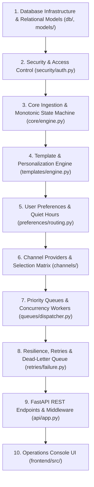

# Step 3: Step-by-Step Rebuild Order

This guide details how to build OmniPost (`20-notification-delivery-platform`) from absolute scratch in the exact logical order of features, highlighting key code snippets, file paths, and architectural reasoning.

---

## Rebuild Dependency Hierarchy



---

## Step 1: Database Infrastructure & Relational Schemas

### Goal
Establish an asynchronous database connection pool and create the 9 foundational relational stores (`notifications`, `templates`, `user_preferences`, `delivery_attempts`, `provider_configs`, `scheduled_jobs`, `queue_state`, `api_keys`, `audit_records`).

### Files Created
- `backend/src/db/database.py`: SQLAlchemy AsyncEngine and async session factory.
- `backend/src/models/store.py`: Declarative ORM models, Pydantic v2 validation schemas, and `NotificationStoreManager` CRUD operations.

### Key Code Snippet (`backend/src/db/database.py`)
```python
DATABASE_URL = os.getenv("DATABASE_URL", "sqlite+aiosqlite:///:memory:")

engine = create_async_engine(DATABASE_URL, echo=False)
AsyncSessionLocal = async_sessionmaker(engine, expire_on_commit=False, class_=AsyncSession)
Base = declarative_base()

async def get_db():
    async with AsyncSessionLocal() as session:
        yield session

async def init_db(custom_engine=None):
    eng = custom_engine or engine
    async with eng.begin() as conn:
        await conn.run_sync(Base.metadata.create_all)
```

---

## Step 2: Security, RBAC & Multi-Tenant Isolation

### Goal
Implement SHA-256 API key hashing, deny-by-default Role-Based Access Control, and strict multi-tenant isolation.

### Files Created
- `backend/src/security/auth.py`: `Role`, `Permission`, `ROLE_PERMISSIONS`, `AuthContext`, and `authenticate_request`.

### Key Code Snippet (`backend/src/security/auth.py`)
```python
class Role(str, Enum):
    ADMIN = "ADMIN"
    OPERATOR = "OPERATOR"
    VIEWER = "VIEWER"

class AuthContext(BaseModel):
    tenant_id: str
    key_id: str
    role: str
    name: str

    def verify_tenant(self, target_tenant_id: str) -> None:
        if self.tenant_id != target_tenant_id:
            raise HTTPException(
                status_code=status.HTTP_403_FORBIDDEN,
                detail=f"Access denied: cannot access resources for tenant '{target_tenant_id}'"
            )
```

---

## Step 3: Core Ingestion & Monotonic State Machine

### Goal
Validate incoming notification payloads, normalize E.164 phone numbers and emails, enforce idempotency keys, and enforce legal forward-only state transitions.

### Files Created
- `backend/src/core/engine.py`: `NotificationRequestPayload`, `NotificationCoreEngine`, `VALID_TRANSITIONS`.

### Key Code Snippet (`backend/src/core/engine.py`)
```python
VALID_TRANSITIONS = {
    NotificationStatus.PENDING.value: [NotificationStatus.QUEUED.value, NotificationStatus.DISPATCHING.value, NotificationStatus.SUPPRESSED.value, NotificationStatus.FAILED.value],
    NotificationStatus.QUEUED.value: [NotificationStatus.DISPATCHING.value, NotificationStatus.FAILED.value, NotificationStatus.SUPPRESSED.value],
    NotificationStatus.DISPATCHING.value: [NotificationStatus.DELIVERED.value, NotificationStatus.FAILED.value, NotificationStatus.QUEUED.value],
    NotificationStatus.DELIVERED.value: [],
    NotificationStatus.FAILED.value: [NotificationStatus.QUEUED.value],
    NotificationStatus.SUPPRESSED.value: []
}
```

---

## Step 4: Template & Personalization Engine

### Goal
Provide secure template rendering via Jinja2's `SandboxedEnvironment` to prevent Server-Side Template Injection (SSTI), support language fallback chains, and personalize content.

### Files Created
- `backend/src/templates/engine.py`: `TemplateEngine`, `SandboxedEnvironment` parser.

---

## Step 5: User Preferences & Quiet Hours

### Goal
Enforce global opt-outs, channel-specific preferences, rolling 24-hour frequency capping, and timezone-aware quiet hours with Daylight Saving Time handling.

### Files Created
- `backend/src/preferences/routing.py`: `PreferenceRoutingEngine`, `is_in_quiet_hours`.

---

## Step 6: Multi-Channel Provider Adapters & Selection

### Goal
Abstract channel communication via `BaseProvider`, implement Email, SMS segment counting, and Webhook HMAC signatures, and deterministically sort providers by capability and cost.

### Files Created
- `backend/src/channels/providers.py`: `EmailChannelProvider`, `SMSChannelProvider`, `WebhookChannelProvider`, `ProviderRegistry`.
- `backend/src/channels/capabilities.py`: `ProviderCapabilityMatrix`.
- `backend/src/channels/selection.py`: `ProviderSelector`.
- `backend/src/channels/credentials.py`: `ProviderCredentialManager`.

---

## Step 7: Priority Queues & Concurrency Workers

### Goal
Implement lease-based queue locking, starvation protection, and token bucket rate limiters consumed by asynchronous background workers.

### Files Created
- `backend/src/queues/dispatcher.py`: `PriorityQueueManager`, `TokenBucketRateLimiter`, `DispatcherWorker`.

---

## Step 8: Resilience, Retries & Dead-Letter Queue

### Goal
Classify failures into transient vs permanent, calculate exponential backoff with full jitter, route exhausted notifications to the DLQ, and enable manual redrive and replay.

### Files Created
- `backend/src/retries/failure.py`: `FailureClassifier`, `RetryPolicy`, `DeadLetterQueueManager`.

---

## Step 9: FastAPI Application & REST Endpoints

### Goal
Wire all components into asynchronous REST endpoints with request correlation IDs, global error handling, and Prometheus telemetry.

### Files Created
- `backend/src/api/app.py`: FastAPI endpoints, CORS, request ID middleware.
- `backend/src/observability/metrics.py`: `DeliveryMetricsTracker`.

---

## Step 10: Frontend Operations Console

### Goal
Build a responsive single-page operations command center in vanilla JavaScript and CSS3 to monitor delivery feeds, provider health, queues, and dead-lettered messages.

### Files Created
- `frontend/src/index.html`: Dashboard layout and modals.
- `frontend/src/app.js`: Client-side state manager and API consumer.
- `frontend/src/index.css`: Dark-mode glassmorphic design system.
