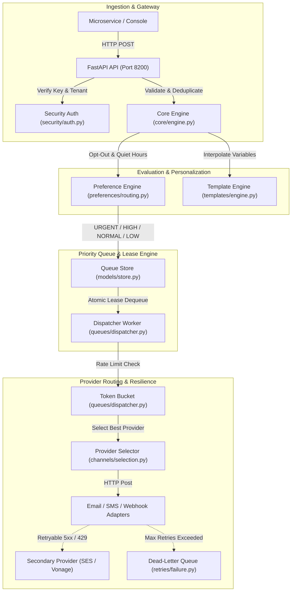
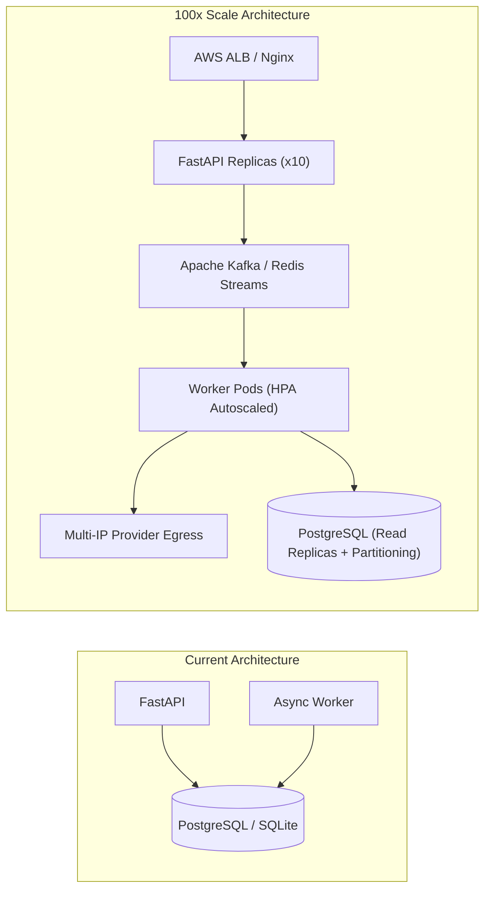

# Step 6: System Architecture & Scaling

## High-Level Architecture Overview

OmniPost is designed around decoupled, asynchronous pipeline stages where ingestion, business rule evaluation, queuing, and provider dispatch are separated by explicit state barriers.

---

## Scaling OmniPost to 100x Traffic (10M Notifications/Day)

At 100 times the current load (~100 to 1,000 requests per second continuously):

### The First Three Bottlenecks
1. **Database Queue Lock Contention**: Running `dequeue_item` with `UPDATE queue_state ... WHERE item_id = (...)` causes database row and index locking contention when hundreds of concurrent workers query the same table.
2. **Synchronous Ingestion Connection Pool Exhaustion**: Direct database writes inside the HTTP request handler exhaust available SQLAlchemy connection pool slots during sudden traffic spikes.
3. **Upstream Vendor Rate Limits**: Third-party providers (Twilio SMS short codes at 100 rps, SendGrid IP pools) reject incoming volume with HTTP 429 Too Many Requests.

### Architectural Scaling Evolution

1. **Replace DB Queue with Kafka or SQS**: Shift queue state from relational tables into Apache Kafka with 16 partitions keyed by `tenant_id` or recipient hash.
2. **Asynchronous Ingestion Buffering**: The FastAPI gateway writes incoming payloads directly into Kafka in <5ms, returning an immediate `202 Accepted` without touching relational tables.
3. **Distributed Token Bucket via Redis**: Migrate process-local token buckets into Redis clusters using atomic Lua scripts (`EVALSHA`) to enforce global rate limits across all distributed worker nodes.
