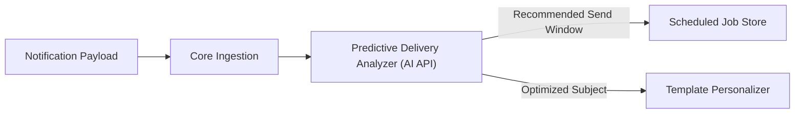

# Step 8: AI Integration & Predictive Delivery Architecture

## 1. AI Integration Scope in OmniPost

OmniPost integrates predictive delivery optimization and pre-trained AI capabilities through standard APIs without training custom machine learning models from scratch.

### Architectural Responsibilities:
- **Optimal Send-Time Optimization (STO)**: Predicting recipient engagement probability based on historical open and interaction timestamps.
- **Smart Subject-Line Generation & Truncation**: Generating concise, engaging subject lines with deterministic character caps.
- **Delivery Anomaly Detection**: Identifying statistical spikes in provider bounce rates or carrier filtering.

---

## 2. Why Use a Pre-Trained API vs Training a Custom Model?

| Dimension | Pre-Trained API (OpenAI / Anthropic / Bedrock) | Custom Trained In-House Model |
| :--- | :--- | :--- |
| **Infrastructure Overhead** | Zero GPU management; stateless HTTP requests. | Multi-node GPU clusters (A100/H100), PyTorch training pipelines. |
| **Cold-Start Time** | Ready in minutes using structured prompts. | Months of data labeling, data cleaning, and hyperparameter tuning. |
| **Maintenance Burden** | Managed availability, automated upgrades. | Model drift monitoring, continuous retraining, data pipeline ops. |
| **Total Cost** | Pay-per-token API cost (~$0.0005 per message). | Tens of thousands of dollars in fixed monthly cloud compute costs. |

---

## 3. Fallbacks & Vendor Independence

If the external AI provider times out or returns HTTP 429 rate limits:
1. **Deterministic Rule Fallback**: If optimal send-time prediction fails, the engine falls back to standard user quiet-hours evaluation (`preferences/routing.py`).
2. **Template Subject Fallback**: If dynamic subject optimization fails, the engine renders the static registered subject template directly.
3. **Provider Abstraction Layer**: The AI client is wrapped in a common interface, allowing immediate switching between OpenAI, Anthropic Claude, or local Ollama instances via environment variables.
