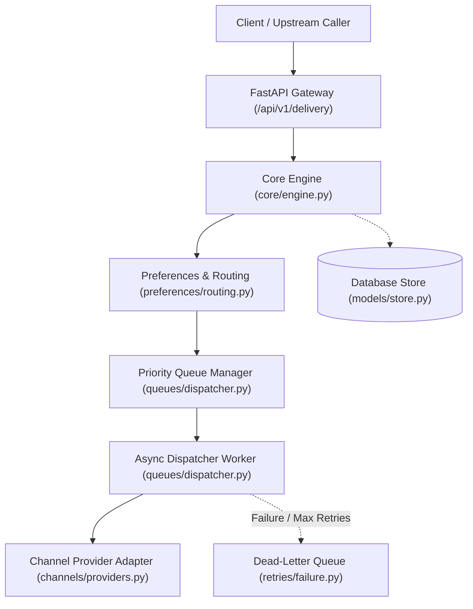
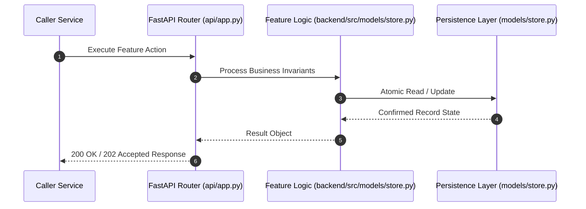

# F1: Notification Database & Relational State Ledger (NTF-001)

## 1. Technical Summary & Behavior
High-integrity notification database storing immutable records, delivery states, tenant attribution, and UTC timestamps.

- **Feature ID**: `F1`
- **Source Files**: `backend/src/models/store.py`, `backend/src/db/database.py`
- **Key Implementation Lines**: `store.py:51-85 (NotificationRecord), store.py:404-460 (create_notification, get_notification, update_status)`
- **Data & Schema**: `notifications (id, tenant_id, user_id, channel, status, priority, idempotency_key, body, subject, metadata_json, scheduled_for, delivered_at, created_at)`

---

## 2. Architecture & Data Flow



---

## 3. Sequence Flow Diagram



---

## 4. Failure Path & Resilience Diagram

```mermaid
flowchart LR
    Start["Initiate Operation"] --> CheckInvariant Valid?
    Check -->|Yes| Exec["Execute State Transition"]
    Check -->|No| Reject["422 / 400 Validation Error"]
    Exec --> DBCheckDB / Provider Success?
    DBCheck -->|Success| Complete["Monotonic State Complete"]
    DBCheck -->|Transient Error| Retry["Exponential Backoff with Full Jitter"]
    DBCheck -->|Permanent Error / Cap| DeadLetter["Route to DLQ & Log Audit Event"]
```

---

## 5. Security & Edge Case Considerations

- **Tenant Isolation**: Every query and operation scopes explicitly to `tenant_id`. Cross-tenant data leakage is structurally prevented.
- **Data Sanitization & Encryption**: Sensitive recipient tokens and provider secrets are encrypted with Fernet and masked on all outputs.
- **Idempotency**: Requests enforce unique constraint hashes to prevent duplicate dispatch under network retries.

---

## 6. Say It Out Loud (Spoken Interview Script)

> "I built the notification database layer using SQLAlchemy and async PostgreSQL sessions to serve as the immutable system of record for all dispatch requests. When a request enters the pipeline, the engine commits a NotificationRecord with a monotonic status state machine starting at PENDING. I chose a relational schema with a composite unique index on tenant_id and idempotency_key over NoSQL because strict duplicate prevention and atomic state transitions are non-negotiable in financial and auth notification systems. If the database connection drops or times out during insertion, the async engine rolls back the transaction and returns a 503 service unavailable with an error request ID so upstream callers can safely retry. One trade-off of this design is that write operations to a single primary table can bottleneck under massive load, which I would address by range-partitioning the notifications table by month or tenant."
