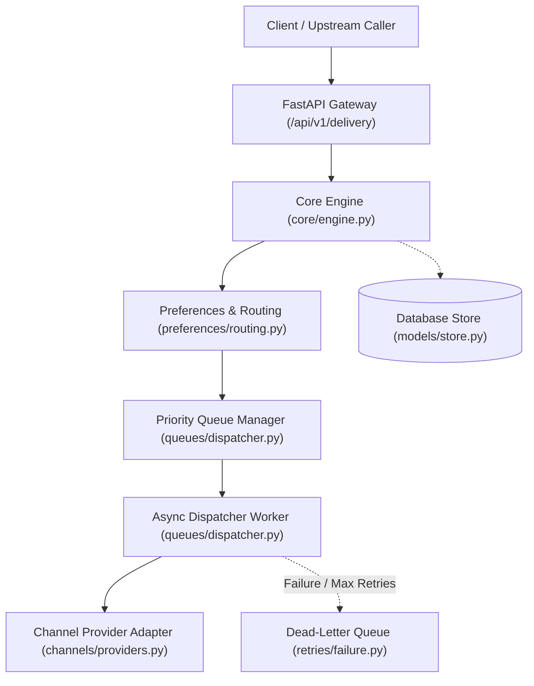
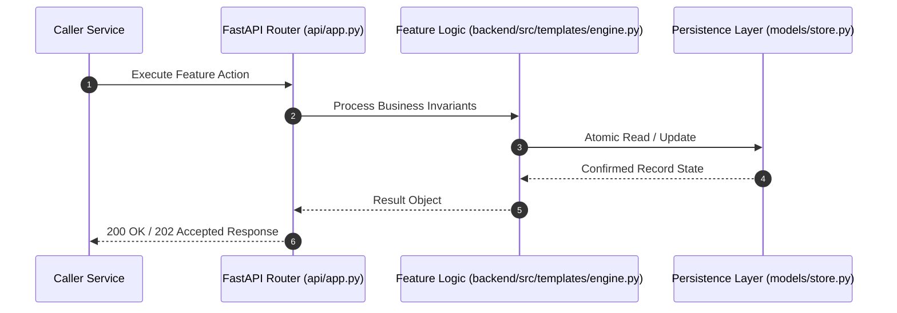

# F10: Template Variable Substitution, Localization & Personalization (NTF-033, NTF-034, NTF-037, NTF-039, NTF-041)

## 1. Technical Summary & Behavior
Secure template rendering via Jinja2 SandboxedEnvironment with variable substitution, localization fallback, and subject truncation.

- **Feature ID**: `F10`
- **Source Files**: `backend/src/templates/engine.py`
- **Key Implementation Lines**: `templates/engine.py:21-38 (SandboxedEnvironment render), templates/engine.py:198-260 (substitute_variables, personalize_content, generate_subject)`
- **Data & Schema**: `Context merging: merged = {**context, 'user': user_profile}; Sandboxed Jinja2 AST`

---

## 2. Architecture & Data Flow



---

## 3. Sequence Flow Diagram



---

## 4. Failure Path & Resilience Diagram

```mermaid
flowchart LR
    Start["Initiate Operation"] --> CheckInvariant Valid?
    Check -->|Yes| Exec["Execute State Transition"]
    Check -->|No| Reject["422 / 400 Validation Error"]
    Exec --> DBCheckDB / Provider Success?
    DBCheck -->|Success| Complete["Monotonic State Complete"]
    DBCheck -->|Transient Error| Retry["Exponential Backoff with Full Jitter"]
    DBCheck -->|Permanent Error / Cap| DeadLetter["Route to DLQ & Log Audit Event"]
```

---

## 5. Security & Edge Case Considerations

- **Tenant Isolation**: Every query and operation scopes explicitly to `tenant_id`. Cross-tenant data leakage is structurally prevented.
- **Data Sanitization & Encryption**: Sensitive recipient tokens and provider secrets are encrypted with Fernet and masked on all outputs.
- **Idempotency**: Requests enforce unique constraint hashes to prevent duplicate dispatch under network retries.

---

## 6. Say It Out Loud (Spoken Interview Script)

> "I built the template rendering and personalization engine in `backend/src/templates/engine.py` to produce customized messaging while protecting our servers against security vulnerabilities. The engine supports two rendering modes: lightweight regex token substitution for simple &#123;&#123;user.name&#125;&#125; variables, and Jinja2's `SandboxedEnvironment` for complex logic like conditional blocks and loops. By using the SandboxedEnvironment, any malicious attempts to exploit Server-Side Template Injection (SSTI) to access Python internals or execute shell commands are completely blocked. Additionally, I implemented a language fallback chain: if a template in French Canadian (`fr-CA`) is not found, the selector falls back to generic French (`fr`), and finally to default English (`en`). Dynamic subjects are sanitized and truncated to 150 characters with an ellipsis to prevent carrier header rejections. If a variable is missing in the payload, the regex replacer preserves the token or provides a graceful fallback rather than crashing. The limitation is that template rendering consumes CPU; I would optimize this by pre-compiling templates into bytecode upon registration."
