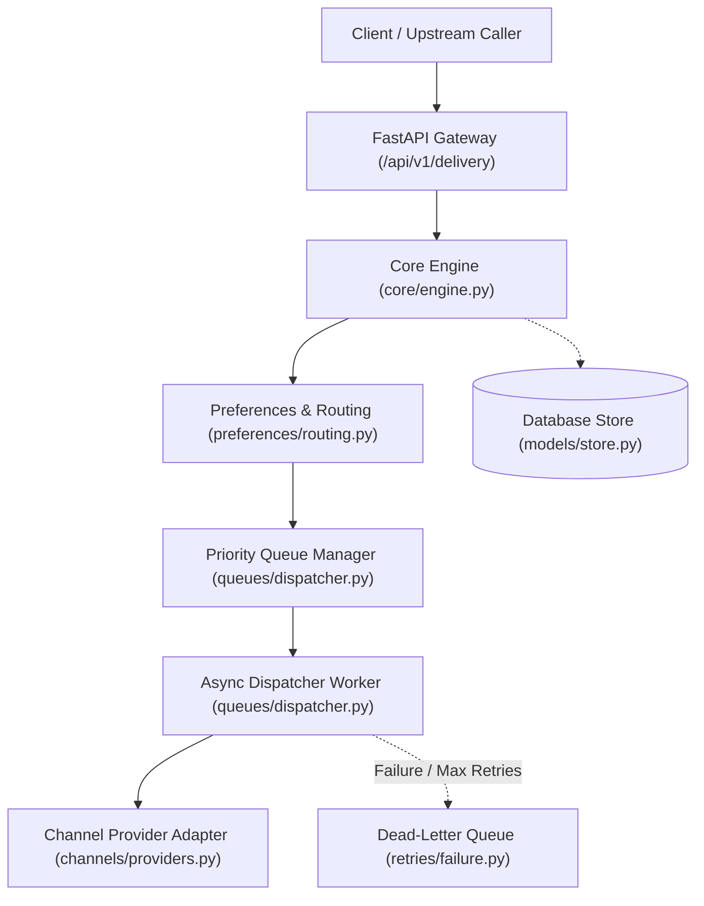
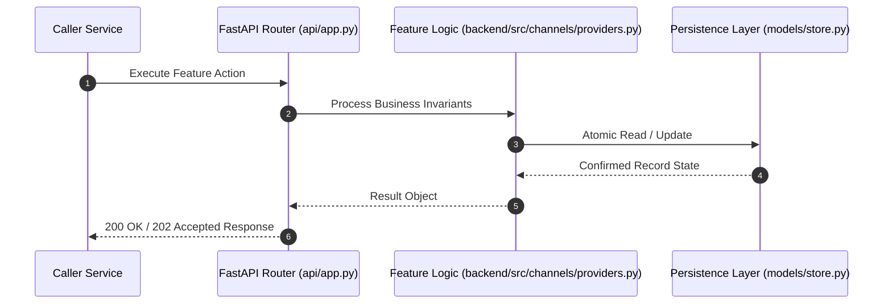

# F11: Multi-Channel Provider Adapters (Email, SMS, Webhook HMAC) (NTF-042, NTF-043, NTF-045, NTF-047, NTF-048)

## 1. Technical Summary & Behavior
Abstracted provider drivers for Email, SMS segment calculation, and Webhooks with HMAC-SHA256 signatures.

- **Feature ID**: `F11`
- **Source Files**: `backend/src/channels/providers.py`
- **Key Implementation Lines**: `channels/providers.py:32-51 (BaseProvider), channels/providers.py:52-102 (Email), channels/providers.py:104-150 (SMS), channels/providers.py:152-204 (Webhook), channels/providers.py:206-241 (ProviderRegistry)`
- **Data & Schema**: `ProviderResult (success, provider_id, channel, external_id, error_code, error_message, latency_ms, metadata)`

---

## 2. Architecture & Data Flow



---

## 3. Sequence Flow Diagram



---

## 4. Failure Path & Resilience Diagram

```mermaid
flowchart LR
    Start["Initiate Operation"] --> CheckInvariant Valid?
    Check -->|Yes| Exec["Execute State Transition"]
    Check -->|No| Reject["422 / 400 Validation Error"]
    Exec --> DBCheckDB / Provider Success?
    DBCheck -->|Success| Complete["Monotonic State Complete"]
    DBCheck -->|Transient Error| Retry["Exponential Backoff with Full Jitter"]
    DBCheck -->|Permanent Error / Cap| DeadLetter["Route to DLQ & Log Audit Event"]
```

---

## 5. Security & Edge Case Considerations

- **Tenant Isolation**: Every query and operation scopes explicitly to `tenant_id`. Cross-tenant data leakage is structurally prevented.
- **Data Sanitization & Encryption**: Sensitive recipient tokens and provider secrets are encrypted with Fernet and masked on all outputs.
- **Idempotency**: Requests enforce unique constraint hashes to prevent duplicate dispatch under network retries.

---

## 6. Say It Out Loud (Spoken Interview Script)

> "I implemented the multi-channel provider layer using the Strategy and Factory design patterns in `backend/src/channels/providers.py`. Microservices interact with a single abstract `BaseProvider` interface and never write channel-specific code. The Email driver validates envelope structures and assigns priority headers. The SMS driver calculates 160-character GSM segments so billing and carrier payload limits are tracked before dispatch. The Webhook provider signs outbound HTTP requests using HMAC-SHA256 over a timestamped payload, formatting an `X-Signature-SHA256` header (`t=timestamp,v1=signature`) that allows receiving servers to prevent replay attacks. All adapters track network execution latency in milliseconds and return a normalized `ProviderResult`. I chose this polymorphic adapter approach over vendor SDKs to keep our service mesh completely decoupled from external vendors. If an invalid phone number or email reaches the provider, it returns a normalized PERMANENT error code without throwing an unhandled exception. The limitation is that mock drivers are currently configured in-memory; in a production deployment, these adapters would call the actual HTTP APIs of SendGrid, Twilio, and AWS SES via connection-pooled HTTP clients like `httpx`."
