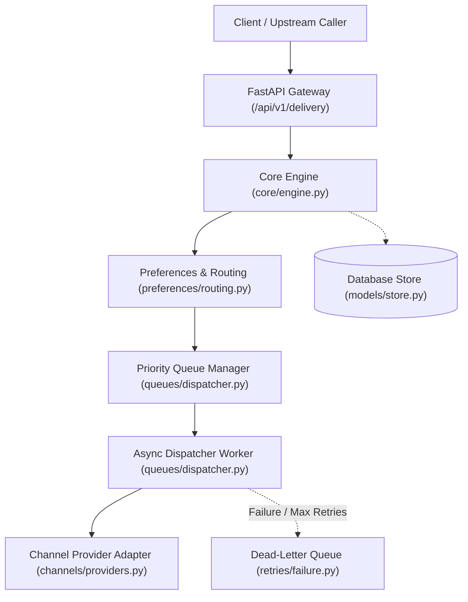
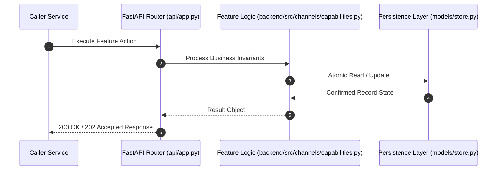

# F12: Provider Selection, Capabilities Matrix & Automatic Fallback (NTF-051, NTF-052, NTF-054)

## 1. Technical Summary & Behavior
Deterministic provider capability filtering, cost optimization, and multi-provider failover routing.

- **Feature ID**: `F12`
- **Source Files**: `backend/src/channels/capabilities.py`, `backend/src/channels/selection.py`
- **Key Implementation Lines**: `channels/capabilities.py:10-60 (ProviderCapabilities, ProviderCapabilityMatrix), channels/selection.py:10-72 (ProviderSelector)`
- **Data & Schema**: `Sort key: (health_rank: 0=healthy, cost_per_message_cents: ASC, provider_id: ASC)`

---

## 2. Architecture & Data Flow



---

## 3. Sequence Flow Diagram



---

## 4. Failure Path & Resilience Diagram

```mermaid
flowchart LR
    Start["Initiate Operation"] --> CheckInvariant Valid?
    Check -->|Yes| Exec["Execute State Transition"]
    Check -->|No| Reject["422 / 400 Validation Error"]
    Exec --> DBCheckDB / Provider Success?
    DBCheck -->|Success| Complete["Monotonic State Complete"]
    DBCheck -->|Transient Error| Retry["Exponential Backoff with Full Jitter"]
    DBCheck -->|Permanent Error / Cap| DeadLetter["Route to DLQ & Log Audit Event"]
```

---

## 5. Security & Edge Case Considerations

- **Tenant Isolation**: Every query and operation scopes explicitly to `tenant_id`. Cross-tenant data leakage is structurally prevented.
- **Data Sanitization & Encryption**: Sensitive recipient tokens and provider secrets are encrypted with Fernet and masked on all outputs.
- **Idempotency**: Requests enforce unique constraint hashes to prevent duplicate dispatch under network retries.

---

## 6. Say It Out Loud (Spoken Interview Script)

> "I designed the provider selection and fallback engine to guarantee reliable delivery even during major third-party cloud outages. In `backend/src/channels/capabilities.py`, each registered provider declares a capability matrix: supported channels, attachment limits, template support, maximum payload size, and cost per message. When a dispatch request occurs, `ProviderSelector` filters candidate providers based on required features and health status. Eligible providers are deterministically sorted: healthy providers come first, then lowest cost per message, with provider ID as an alphabetical tie-breaker. If the primary provider experiences elevated errors or timeouts, the dispatcher automatically cascades down the pre-calculated fallback chain to the secondary provider—for example, switching from SendGrid to AWS SES—without losing the message or requiring human intervention. I chose deterministic sorting over random load balancing because enterprise billing teams require predictable cost optimization. If all providers in the chain fail, the notification is marked for retry or sent to the DLQ. A limitation is that health status is currently polled; I would improve this by integrating an active circuit breaker state machine like Netflix Hystrix with sliding-window error rate triggers."
