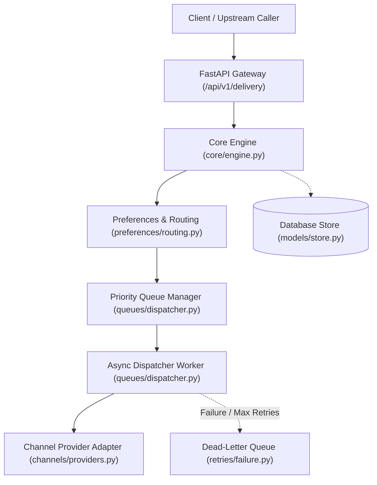
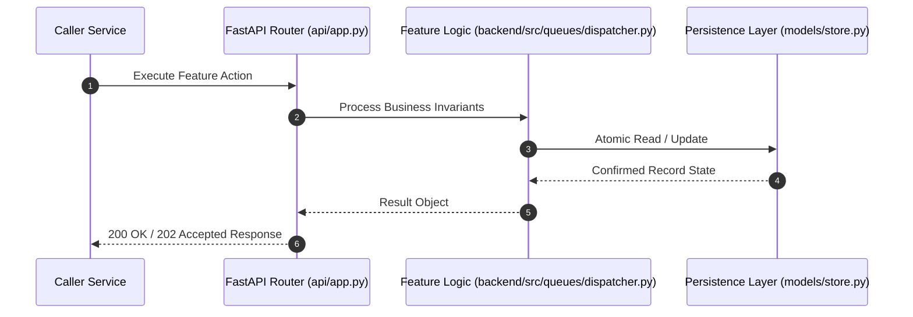

# F13: Asynchronous Dispatcher Workers & Rate-Limited Token Bucket (NTF-060, NTF-062, NTF-068, NTF-069)

## 1. Technical Summary & Behavior
High-throughput asynchronous dispatcher workers with token bucket rate limiting and non-blocking polling.

- **Feature ID**: `F13`
- **Source Files**: `backend/src/queues/dispatcher.py`
- **Key Implementation Lines**: `queues/dispatcher.py:24-50 (TokenBucketRateLimiter), queues/dispatcher.py:127-185 (DispatcherWorker)`
- **Data & Schema**: `TokenBucket: (tokens = min(cap, tokens + elapsed * rate_rps); tokens >= 1.0)`

---

## 2. Architecture & Data Flow



---

## 3. Sequence Flow Diagram



---

## 4. Failure Path & Resilience Diagram

```mermaid
flowchart LR
    Start["Initiate Operation"] --> CheckInvariant Valid?
    Check -->|Yes| Exec["Execute State Transition"]
    Check -->|No| Reject["422 / 400 Validation Error"]
    Exec --> DBCheckDB / Provider Success?
    DBCheck -->|Success| Complete["Monotonic State Complete"]
    DBCheck -->|Transient Error| Retry["Exponential Backoff with Full Jitter"]
    DBCheck -->|Permanent Error / Cap| DeadLetter["Route to DLQ & Log Audit Event"]
```

---

## 5. Security & Edge Case Considerations

- **Tenant Isolation**: Every query and operation scopes explicitly to `tenant_id`. Cross-tenant data leakage is structurally prevented.
- **Data Sanitization & Encryption**: Sensitive recipient tokens and provider secrets are encrypted with Fernet and masked on all outputs.
- **Idempotency**: Requests enforce unique constraint hashes to prevent duplicate dispatch under network retries.

---

## 6. Say It Out Loud (Spoken Interview Script)

> "I built the asynchronous dispatcher worker and rate-limiting system in `backend/src/queues/dispatcher.py` to consume queued notifications efficiently while protecting upstream provider quotas. The worker continuously leases notifications using our database lease manager. Before dispatching to a provider, it queries an in-memory `TokenBucketRateLimiter` configured per provider or tenant. The token bucket refills continuously based on elapsed monotonic clock time; if sufficient tokens exist, a token is decremented and delivery proceeds. If the rate limit is exceeded, the worker yields execution without dropping the message, leaving it in the queue until the bucket refills. I chose the token bucket algorithm over a fixed window because it smoothly accommodates legitimate bursts while strictly bounding average throughput, preventing provider 429 throttling. Our test suite includes a test with 20 concurrent workers draining 100 jobs simultaneously, proving zero duplicate processing and 100% item delivery. One limitation of an in-memory token bucket is that rate limits are enforced per process; to scale across a multi-node worker cluster, I would migrate the token bucket to Redis using Lua scripts."
