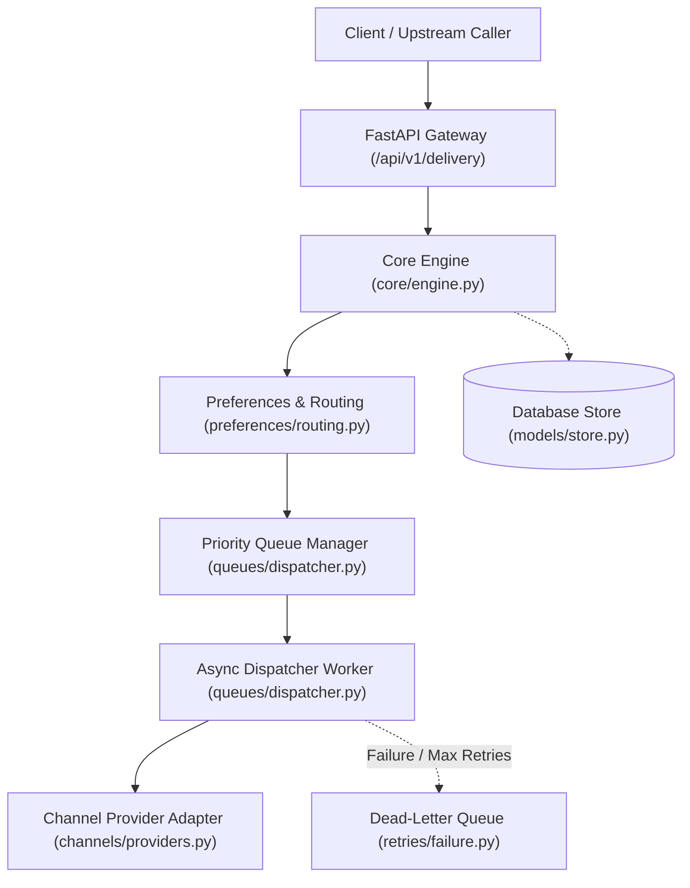
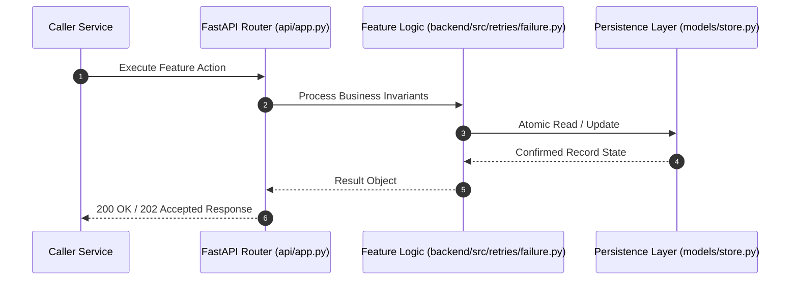

# F14: Failure Classification, Exponential Backoff & DLQ Redrive/Replay (NTF-070, NTF-071, NTF-073, NTF-075, NTF-076, NTF-077, NTF-078, NTF-081, NTF-082, NTF-083)

## 1. Technical Summary & Behavior
Resilience engine classifying errors into transient vs permanent, calculating backoff with jitter, and managing DLQ redrives.

- **Feature ID**: `F14`
- **Source Files**: `backend/src/retries/failure.py`
- **Key Implementation Lines**: `retries/failure.py:30-94 (FailureClassifier), retries/failure.py:95-129 (RetryPolicy), retries/failure.py:153-330 (DeadLetterQueueManager)`
- **Data & Schema**: `dead_letter_queue (id, notification_id, tenant_id, failure_reason, attempt_count, created_at)`

---

## 2. Architecture & Data Flow



---

## 3. Sequence Flow Diagram



---

## 4. Failure Path & Resilience Diagram

```mermaid
flowchart LR
    Start["Initiate Operation"] --> CheckInvariant Valid?
    Check -->|Yes| Exec["Execute State Transition"]
    Check -->|No| Reject["422 / 400 Validation Error"]
    Exec --> DBCheckDB / Provider Success?
    DBCheck -->|Success| Complete["Monotonic State Complete"]
    DBCheck -->|Transient Error| Retry["Exponential Backoff with Full Jitter"]
    DBCheck -->|Permanent Error / Cap| DeadLetter["Route to DLQ & Log Audit Event"]
```

---

## 5. Security & Edge Case Considerations

- **Tenant Isolation**: Every query and operation scopes explicitly to `tenant_id`. Cross-tenant data leakage is structurally prevented.
- **Data Sanitization & Encryption**: Sensitive recipient tokens and provider secrets are encrypted with Fernet and masked on all outputs.
- **Idempotency**: Requests enforce unique constraint hashes to prevent duplicate dispatch under network retries.

---

## 6. Say It Out Loud (Spoken Interview Script)

> "I designed the failure handling and recovery engine in `backend/src/retries/failure.py` to build enterprise resilience into our messaging pipeline. When a delivery fails, the `FailureClassifier` evaluates the error code or HTTP response. Permanent errors—like invalid recipient addresses, malformed payloads, or 401 unauthorized—are immediately marked non-retryable and moved to FAILED status, preventing wasted provider spend. Transient errors—like 429 rate limits, 503 service unavailable, or network timeouts—trigger our exponential backoff retry policy. The retry policy calculates delay using the formula `min(max_delay, base_delay * 2^(attempt-1))` with full jitter to prevent thundering herd spikes against recovering providers, while honoring any upstream `Retry-After` HTTP headers. When a notification exhausts all retries, it is routed into the Dead-Letter Queue (DLQ). The operations console can inspect failed messages and trigger manual retries or full replays. Reprocessing a DLQ item re-queues the notification, records a new delivery attempt, and logs an immutable audit event without duplicating delivered alerts. A limitation is that retried messages go back into the main queue; I would improve this by creating dedicated retry delay queues."
