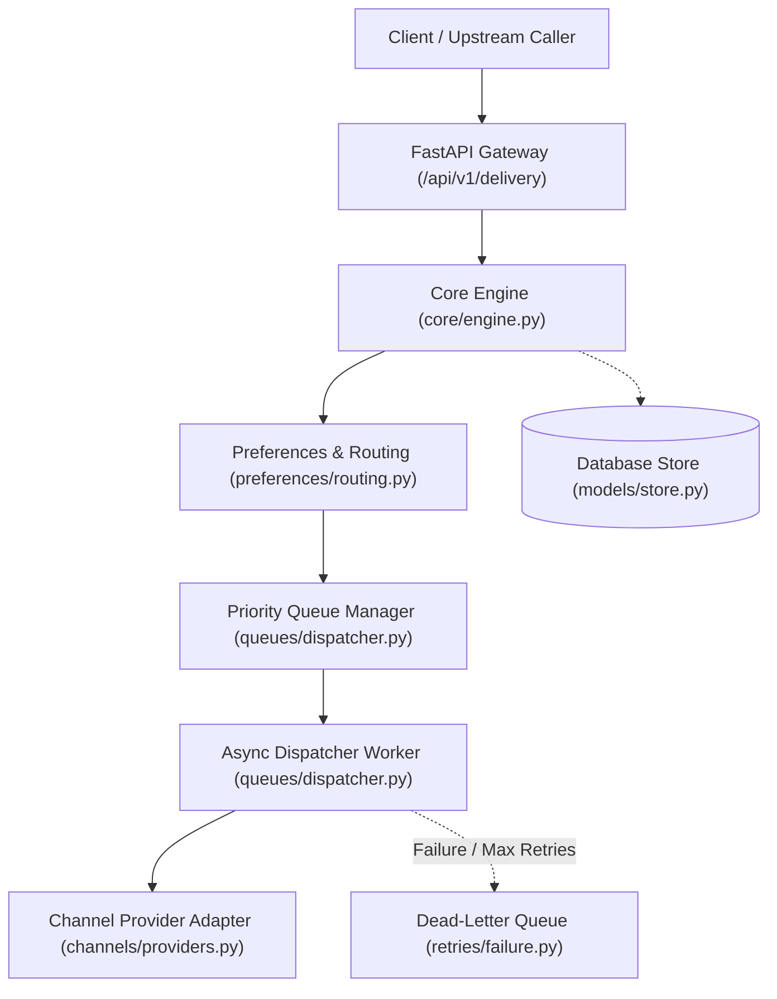
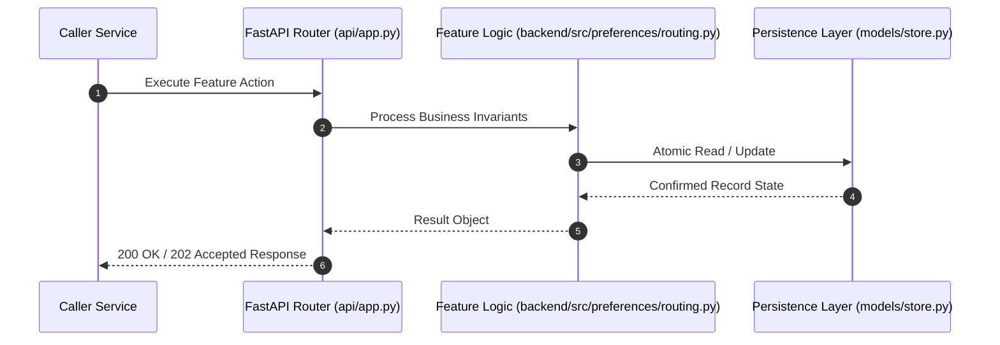

# F15: Timezone-Aware Quiet Hours, Frequency Capping & Opt-Out Suppression (NTF-086, NTF-088, NTF-089, NTF-090, NTF-093)

## 1. Technical Summary & Behavior
Compliance and user experience engine suppressing promotional notifications during recipient quiet hours and daily caps.

- **Feature ID**: `F15`
- **Source Files**: `backend/src/preferences/routing.py`
- **Key Implementation Lines**: `preferences/routing.py:43-81 (is_in_quiet_hours with DST), preferences/routing.py:82-97 (get_daily_send_count), preferences/routing.py:98-180 (evaluate_dispatch)`
- **Data & Schema**: `SuppressionReason: OPT_OUT_GLOBAL | OPT_OUT_CHANNEL | OPT_OUT_CATEGORY | FREQUENCY_CAPPED | QUIET_HOURS`

---

## 2. Architecture & Data Flow



---

## 3. Sequence Flow Diagram



---

## 4. Failure Path & Resilience Diagram

```mermaid
flowchart LR
    Start["Initiate Operation"] --> CheckInvariant Valid?
    Check -->|Yes| Exec["Execute State Transition"]
    Check -->|No| Reject["422 / 400 Validation Error"]
    Exec --> DBCheckDB / Provider Success?
    DBCheck -->|Success| Complete["Monotonic State Complete"]
    DBCheck -->|Transient Error| Retry["Exponential Backoff with Full Jitter"]
    DBCheck -->|Permanent Error / Cap| DeadLetter["Route to DLQ & Log Audit Event"]
```

---

## 5. Security & Edge Case Considerations

- **Tenant Isolation**: Every query and operation scopes explicitly to `tenant_id`. Cross-tenant data leakage is structurally prevented.
- **Data Sanitization & Encryption**: Sensitive recipient tokens and provider secrets are encrypted with Fernet and masked on all outputs.
- **Idempotency**: Requests enforce unique constraint hashes to prevent duplicate dispatch under network retries.

---

## 6. Say It Out Loud (Spoken Interview Script)

> "I built the quiet hours and frequency capping engine in `backend/src/preferences/routing.py` to prevent notification fatigue and ensure compliance with telecom quiet-hours regulations. When evaluating an outbound notification, the engine converts current UTC time into the recipient's local IANA timezone using Python's `zoneinfo` module, properly accounting for Daylight Saving Time shifts. The quiet-hours algorithm seamlessly handles overnight wrap-around windows—such as 10:00 PM to 8:00 AM—where start time is numerically greater than end time. If the recipient is in quiet hours or has exceeded their daily frequency cap over a rolling 24-hour window, promotional notifications are suppressed and transitioned to SUPPRESSED status with a clear audit reason. However, critical transactional alerts and URGENT priority messages like password resets and fraud warnings bypass quiet hours and frequency caps completely. I chose native `zoneinfo` over UTC offsets because offsets do not adapt to daylight saving transitions. If an invalid timezone string is provided, the engine safely falls back to UTC. One enhancement I would add is quiet-hours queuing, where suppressed messages are held and automatically released when the recipient's local morning window opens."
