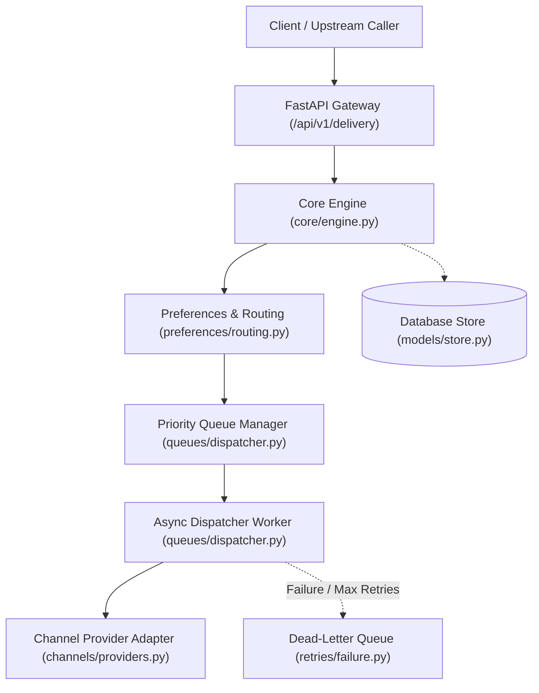
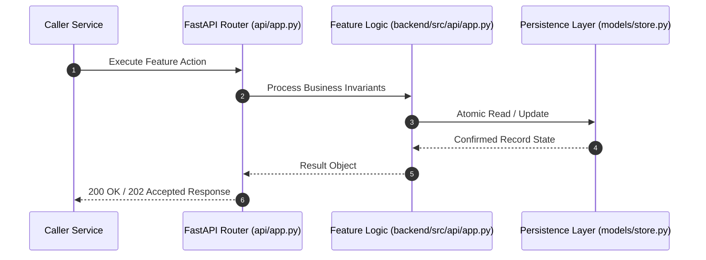

# F16: RESTful Delivery, Scheduling, Retry & Template APIs (NTF-098, NTF-099, NTF-100, NTF-101, NTF-103, NTF-105, NTF-109, NTF-110)

## 1. Technical Summary & Behavior
Unified REST API endpoints for dispatching, status tracking, delayed scheduling, DLQ reprocessing, and health checks.

- **Feature ID**: `F16`
- **Source Files**: `backend/src/api/app.py`
- **Key Implementation Lines**: `api/app.py:107-140 (Health & Ready), api/app.py:192-315 (Delivery API), api/app.py:319-365 (Schedule API), api/app.py:371-450 (Retry & DLQ API), api/app.py:481-515 (Template API)`
- **Data & Schema**: `FastAPI ASGI routes with Pydantic request/response models and OpenAPI documentation`

---

## 2. Architecture & Data Flow



---

## 3. Sequence Flow Diagram



---

## 4. Failure Path & Resilience Diagram

```mermaid
flowchart LR
    Start["Initiate Operation"] --> CheckInvariant Valid?
    Check -->|Yes| Exec["Execute State Transition"]
    Check -->|No| Reject["422 / 400 Validation Error"]
    Exec --> DBCheckDB / Provider Success?
    DBCheck -->|Success| Complete["Monotonic State Complete"]
    DBCheck -->|Transient Error| Retry["Exponential Backoff with Full Jitter"]
    DBCheck -->|Permanent Error / Cap| DeadLetter["Route to DLQ & Log Audit Event"]
```

---

## 5. Security & Edge Case Considerations

- **Tenant Isolation**: Every query and operation scopes explicitly to `tenant_id`. Cross-tenant data leakage is structurally prevented.
- **Data Sanitization & Encryption**: Sensitive recipient tokens and provider secrets are encrypted with Fernet and masked on all outputs.
- **Idempotency**: Requests enforce unique constraint hashes to prevent duplicate dispatch under network retries.

---

## 6. Say It Out Loud (Spoken Interview Script)

> "I implemented the core REST API layer in `backend/src/api/app.py` using FastAPI to provide a clean, asynchronous interface for our entire microservice architecture. The API exposes unified endpoints: `/api/v1/delivery` for ingesting notifications across any channel, `/api/v1/schedule` for future-dated dispatch, `/api/v1/notifications/{id}/retry` and `/replay` for operator interventions, and `/api/v1/dlq/reprocess` for batch dead-letter recovery. The application includes liveness (`/healthz`) and readiness (`/readyz`) probes that verify database connectivity for Kubernetes orchestration. I configured global middleware that injects a unique `X-Request-ID` into every HTTP response header and formats all unhandled exceptions into structured JSON error envelopes. I chose FastAPI over Flask or Django because its asynchronous nature and Pydantic integration offer high throughput and automatic Swagger documentation. If a client submits malformed data, FastAPI returns a detailed 422 Unprocessable Entity response highlighting the invalid parameter. The limitation is that our API currently handles ingress synchronously; at 50,000 requests per second, I would place an API Gateway and an ingestion queue buffer like Kafka in front of these endpoints."
