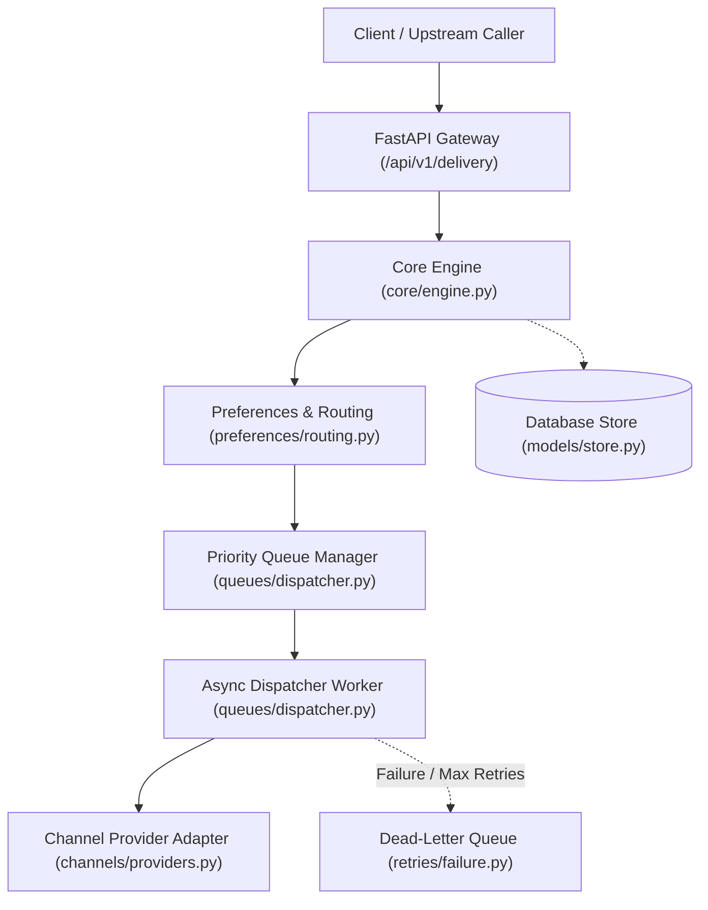
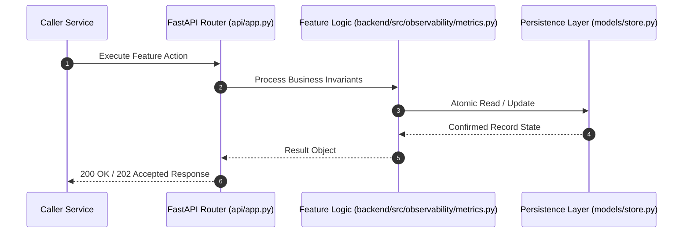

# F17: Structured Logging & Prometheus Metrics Telemetry (NTF-114, NTF-116, NTF-117)

## 1. Technical Summary & Behavior
Telemetry engine generating structured JSON audit logs and Prometheus counters/gauges for delivery latency and error rates.

- **Feature ID**: `F17`
- **Source Files**: `backend/src/observability/metrics.py`, `backend/src/observability/structured_logger.py`
- **Key Implementation Lines**: `observability/metrics.py:12-143 (DeliveryMetricsTracker), observability/structured_logger.py:1-60 (StructuredLogger)`
- **Data & Schema**: `Metrics: notification_delivery_success_total, notification_delivery_failure_total, p50/p95 latency distributions`

---

## 2. Architecture & Data Flow



---

## 3. Sequence Flow Diagram



---

## 4. Failure Path & Resilience Diagram

```mermaid
flowchart LR
    Start["Initiate Operation"] --> CheckInvariant Valid?
    Check -->|Yes| Exec["Execute State Transition"]
    Check -->|No| Reject["422 / 400 Validation Error"]
    Exec --> DBCheckDB / Provider Success?
    DBCheck -->|Success| Complete["Monotonic State Complete"]
    DBCheck -->|Transient Error| Retry["Exponential Backoff with Full Jitter"]
    DBCheck -->|Permanent Error / Cap| DeadLetter["Route to DLQ & Log Audit Event"]
```

---

## 5. Security & Edge Case Considerations

- **Tenant Isolation**: Every query and operation scopes explicitly to `tenant_id`. Cross-tenant data leakage is structurally prevented.
- **Data Sanitization & Encryption**: Sensitive recipient tokens and provider secrets are encrypted with Fernet and masked on all outputs.
- **Idempotency**: Requests enforce unique constraint hashes to prevent duplicate dispatch under network retries.

---

## 6. Say It Out Loud (Spoken Interview Script)

> "I built the observability subsystem in `backend/src/observability/metrics.py` to give engineering and operations teams real-time visibility into messaging health. The `DeliveryMetricsTracker` records every delivery attempt, calculating p50 and p95 latency percentiles, overall success rates, and error code distributions across providers and channels. It formats these metrics into standard Prometheus exposition format via the `/metrics` endpoint. In `backend/src/observability/structured_logger.py`, all application logs are output as structured JSON objects containing timestamps, log levels, tenant IDs, and request correlation IDs. I chose structured JSON over plain text logs so that log ingestion systems like Datadog, Elasticsearch, and CloudWatch can parse and index fields without fragile regular expressions. If an unexpected error occurs, the logger automatically serializes the full stack trace. A limitation of our in-memory metrics tracker is that metrics reset on process restart; for multi-node deployments, I would export metrics directly to a Prometheus Pushgateway or StatsD daemon."
