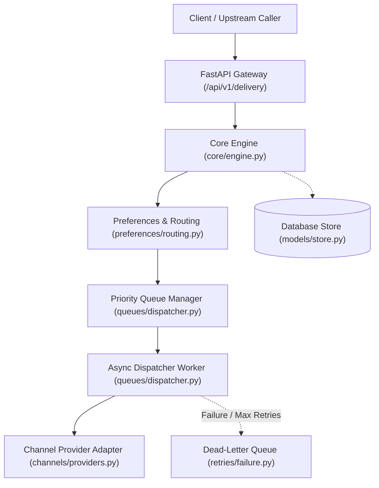
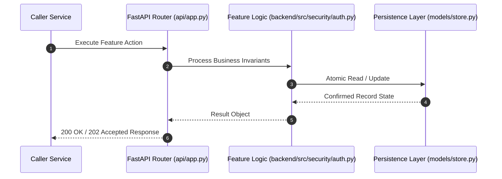

# F18: Security, Hashed API Keys, RBAC & Tenant Isolation (NTF-125, NTF-126, NTF-127, NTF-133)

## 1. Technical Summary & Behavior
Zero-trust security layer enforcing SHA-256 API key hashing, deny-by-default RBAC roles, and adversarial tenant isolation.

- **Feature ID**: `F18`
- **Source Files**: `backend/src/security/auth.py`, `backend/src/models/store.py`
- **Key Implementation Lines**: `security/auth.py:18-55 (Role, Permission, ROLE_PERMISSIONS), security/auth.py:57-78 (AuthContext, verify_tenant), security/auth.py:83-132 (authenticate_request, require_permission)`
- **Data & Schema**: `api_keys (id, tenant_id, key_hash, role, name, is_active); audit_records (id, tenant_id, actor, action, resource_type, resource_id, details_json)`

---

## 2. Architecture & Data Flow



---

## 3. Sequence Flow Diagram



---

## 4. Failure Path & Resilience Diagram

```mermaid
flowchart LR
    Start["Initiate Operation"] --> CheckInvariant Valid?
    Check -->|Yes| Exec["Execute State Transition"]
    Check -->|No| Reject["422 / 400 Validation Error"]
    Exec --> DBCheckDB / Provider Success?
    DBCheck -->|Success| Complete["Monotonic State Complete"]
    DBCheck -->|Transient Error| Retry["Exponential Backoff with Full Jitter"]
    DBCheck -->|Permanent Error / Cap| DeadLetter["Route to DLQ & Log Audit Event"]
```

---

## 5. Security & Edge Case Considerations

- **Tenant Isolation**: Every query and operation scopes explicitly to `tenant_id`. Cross-tenant data leakage is structurally prevented.
- **Data Sanitization & Encryption**: Sensitive recipient tokens and provider secrets are encrypted with Fernet and masked on all outputs.
- **Idempotency**: Requests enforce unique constraint hashes to prevent duplicate dispatch under network retries.

---

## 6. Say It Out Loud (Spoken Interview Script)

> "I designed the security and access control architecture in `backend/src/security/auth.py` adhering to zero-trust principles. Calling microservices authenticate using an API key passed in the `X-API-Key` or `Authorization: Bearer` header. The raw API key is never stored in plaintext; instead, it is hashed using SHA-256 and matched against the `api_keys` database table. I implemented a deny-by-default Role-Based Access Control (RBAC) model with three roles: ADMIN, OPERATOR, and VIEWER. Each endpoint enforces strict permission checks: for example, triggering a DLQ replay requires `notification:retry`, which is granted only to ADMIN and OPERATOR roles. Furthermore, every request enforces adversarial multi-tenant data isolation: if a token belonging to Tenant A attempts to access Tenant B's notification or preference records, the `verify_tenant` method immediately aborts the request with a 403 Forbidden. Every administrative action automatically generates an immutable entry in the `audit_records` table. If an invalid or revoked key is provided, the API returns a 401 Unauthorized. A future enhancement would be adding mutual TLS (mTLS) for inter-service communication."
