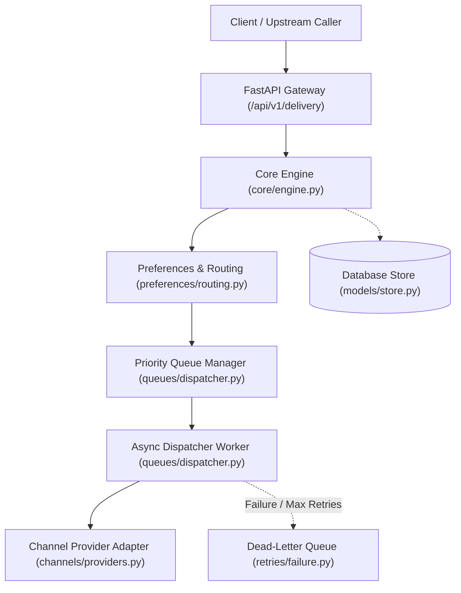
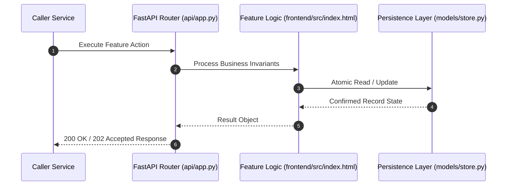

# F19: Operations Console UI & Real-Time Monitoring (NTF-139, NTF-140, NTF-141, NTF-146, NTF-148, NTF-150)

## 1. Technical Summary & Behavior
Responsive single-page operations dashboard with real-time delivery logs, provider fleet health, queue depth, and DLQ viewer.

- **Feature ID**: `F19`
- **Source Files**: `frontend/src/index.html`, `frontend/src/app.js`, `frontend/src/index.css`
- **Key Implementation Lines**: `frontend/src/app.js:1-140 (Navigation, Modals, Forms), frontend/src/app.js:150-455 (API fetching, state management, renderers)`
- **Data & Schema**: `Tabs: Live Delivery Console, Provider Fleet Dashboard, Queue & Worker Monitoring, Dead-Letter Queue Viewer`

---

## 2. Architecture & Data Flow



---

## 3. Sequence Flow Diagram



---

## 4. Failure Path & Resilience Diagram

```mermaid
flowchart LR
    Start["Initiate Operation"] --> CheckInvariant Valid?
    Check -->|Yes| Exec["Execute State Transition"]
    Check -->|No| Reject["422 / 400 Validation Error"]
    Exec --> DBCheckDB / Provider Success?
    DBCheck -->|Success| Complete["Monotonic State Complete"]
    DBCheck -->|Transient Error| Retry["Exponential Backoff with Full Jitter"]
    DBCheck -->|Permanent Error / Cap| DeadLetter["Route to DLQ & Log Audit Event"]
```

---

## 5. Security & Edge Case Considerations

- **Tenant Isolation**: Every query and operation scopes explicitly to `tenant_id`. Cross-tenant data leakage is structurally prevented.
- **Data Sanitization & Encryption**: Sensitive recipient tokens and provider secrets are encrypted with Fernet and masked on all outputs.
- **Idempotency**: Requests enforce unique constraint hashes to prevent duplicate dispatch under network retries.

---

## 6. Say It Out Loud (Spoken Interview Script)

> "I built the frontend operations console using semantic HTML5, modern vanilla JavaScript, and a custom dark-mode CSS design system to give on-call engineers an immediate visual command center. The console features four operational views: an Overview dashboard displaying live delivery KPI counters and a direct notification dispatch form, a Provider Fleet dashboard showing vendor capabilities and status, a Queue Monitor showing backlog depth across priority tiers, and a Dead-Letter Queue viewer with one-click manual redrive buttons. Clicking any notification opens a diagnostic modal displaying the complete delivery attempt history with provider latencies. I chose vanilla JavaScript and native CSS over React or Vue for this internal console to achieve instantaneous load times with zero build-step overhead and zero client bundle bloat. If the backend API is unreachable, the console displays helpful fallback cards and error toasts rather than crashing. One future improvement would be replacing our periodic polling with Server-Sent Events (SSE) or WebSockets to stream live delivery updates instantly."
