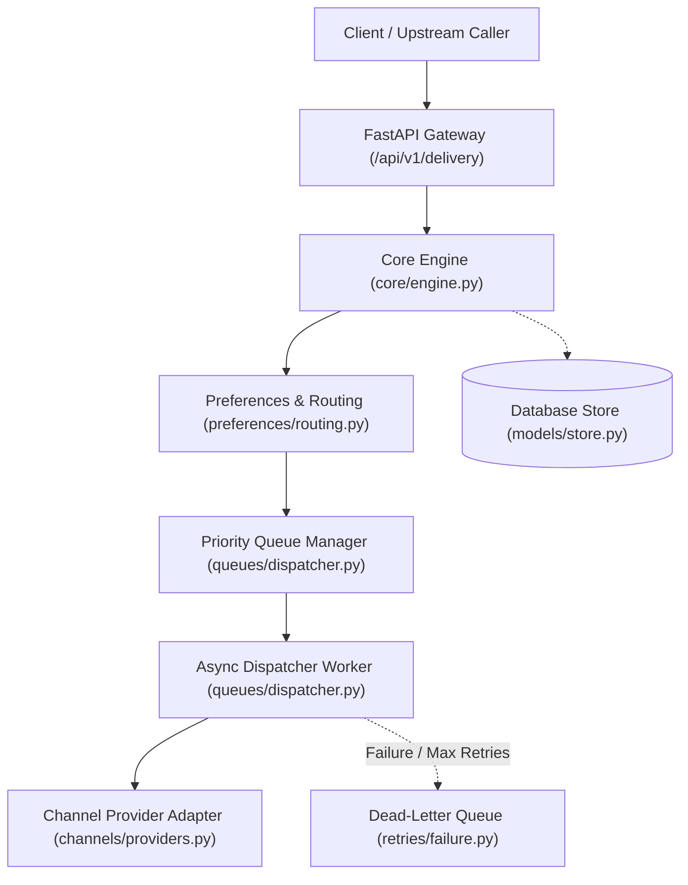
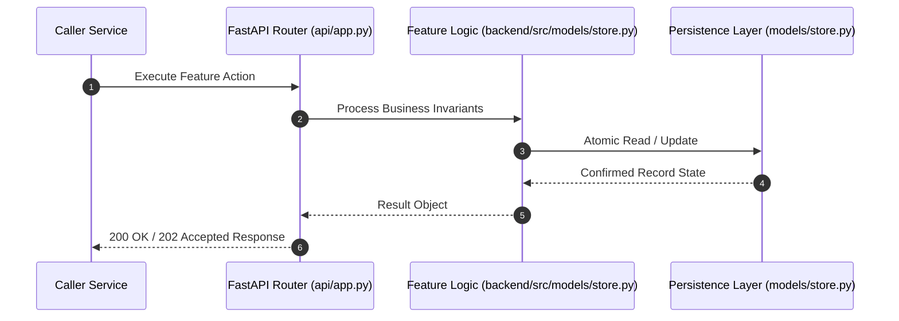

# F2: Template Store, Registry & Versioning (NTF-002, NTF-009, NTF-028, NTF-029)

## 1. Technical Summary & Behavior
Versioned notification template catalog supporting subject and body templates, language tagging, and multi-tenant isolation.

- **Feature ID**: `F2`
- **Source Files**: `backend/src/models/store.py`, `backend/src/templates/engine.py`
- **Key Implementation Lines**: `store.py:89-125 (TemplateRecord), templates/engine.py:39-74 (register_template, get_template_version)`
- **Data & Schema**: `templates (id, tenant_id, name, channel, version, language, body_template, subject_template, status, is_active, approved_by, approved_at, deactivated_by, deactivated_at, created_at)`

---

## 2. Architecture & Data Flow



---

## 3. Sequence Flow Diagram



---

## 4. Failure Path & Resilience Diagram

```mermaid
flowchart LR
    Start["Initiate Operation"] --> CheckInvariant Valid?
    Check -->|Yes| Exec["Execute State Transition"]
    Check -->|No| Reject["422 / 400 Validation Error"]
    Exec --> DBCheckDB / Provider Success?
    DBCheck -->|Success| Complete["Monotonic State Complete"]
    DBCheck -->|Transient Error| Retry["Exponential Backoff with Full Jitter"]
    DBCheck -->|Permanent Error / Cap| DeadLetter["Route to DLQ & Log Audit Event"]
```

---

## 5. Security & Edge Case Considerations

- **Tenant Isolation**: Every query and operation scopes explicitly to `tenant_id`. Cross-tenant data leakage is structurally prevented.
- **Data Sanitization & Encryption**: Sensitive recipient tokens and provider secrets are encrypted with Fernet and masked on all outputs.
- **Idempotency**: Requests enforce unique constraint hashes to prevent duplicate dispatch under network retries.

---

## 6. Say It Out Loud (Spoken Interview Script)

> "I designed the template registry to allow engineering and product teams to manage notification copy independently of application deployments. In `backend/src/templates/engine.py`, templates are identified by tenant, template name, version, and language code. When selecting a template, the engine queries the latest active version or a pinned version number. I rejected storing templates in static JSON files or code constants because business requirements demand zero-downtime copy updates and multilingual support. If a requested template does not exist, the engine raises an explicit ValueError and logs the missing template name. One limitation is that templates are fetched per delivery request; in a high-volume production environment, I would add a local in-memory LRU cache with Redis Pub/Sub invalidation to eliminate database read overhead."
