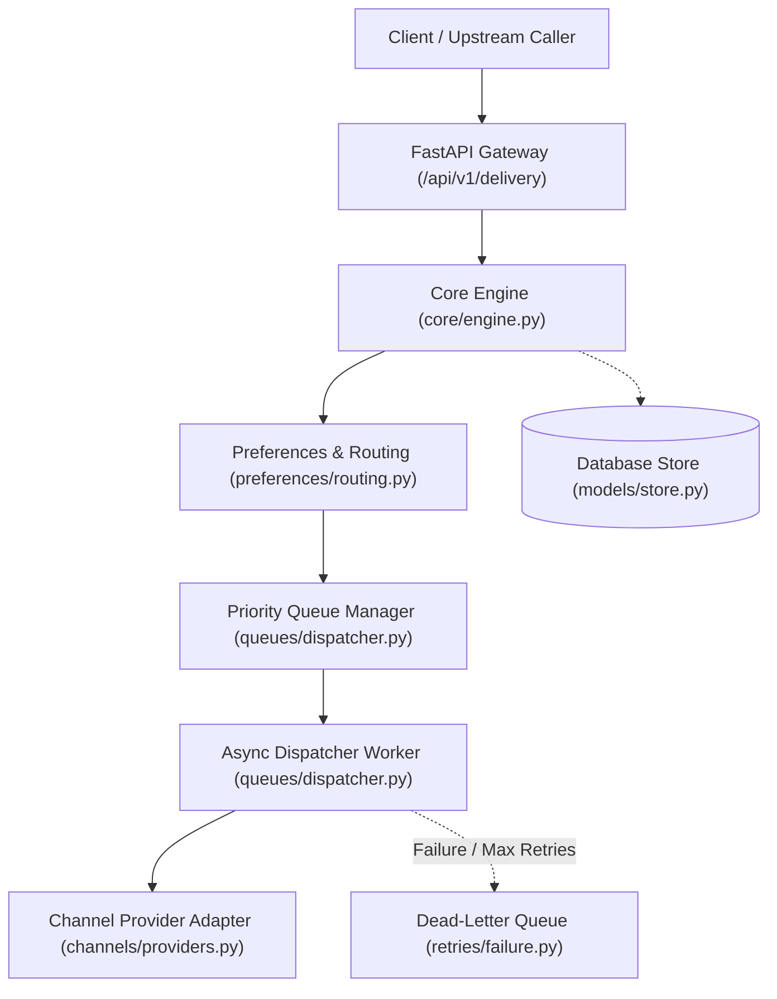
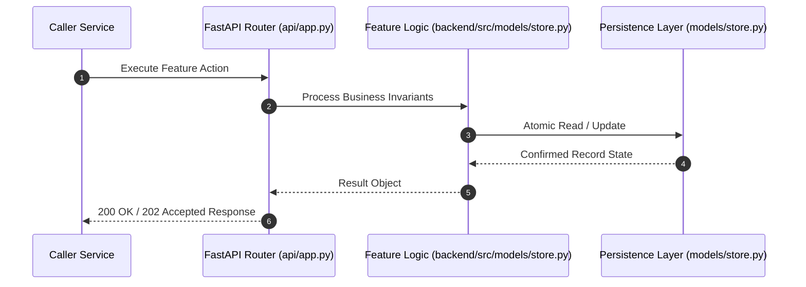

# F3: User Preference Store & Routing Rules (NTF-003, NTF-084, NTF-085, NTF-087)

## 1. Technical Summary & Behavior
Per-user preference store defining global opt-out, channel-level opt-ins, category preferences, and quiet hours configuration.

- **Feature ID**: `F3`
- **Source Files**: `backend/src/models/store.py`, `backend/src/preferences/routing.py`
- **Key Implementation Lines**: `store.py:131-195 (UserPreferenceRecord), preferences/routing.py:98-160 (evaluate_dispatch)`
- **Data & Schema**: `user_preferences (id, tenant_id, user_id, opt_out_all, channel_opt_in_json, categories_opt_in_json, preferred_channel, max_daily_notifications, quiet_hours_start, quiet_hours_end, timezone, updated_at)`

---

## 2. Architecture & Data Flow



---

## 3. Sequence Flow Diagram



---

## 4. Failure Path & Resilience Diagram

```mermaid
flowchart LR
    Start["Initiate Operation"] --> CheckInvariant Valid?
    Check -->|Yes| Exec["Execute State Transition"]
    Check -->|No| Reject["422 / 400 Validation Error"]
    Exec --> DBCheckDB / Provider Success?
    DBCheck -->|Success| Complete["Monotonic State Complete"]
    DBCheck -->|Transient Error| Retry["Exponential Backoff with Full Jitter"]
    DBCheck -->|Permanent Error / Cap| DeadLetter["Route to DLQ & Log Audit Event"]
```

---

## 5. Security & Edge Case Considerations

- **Tenant Isolation**: Every query and operation scopes explicitly to `tenant_id`. Cross-tenant data leakage is structurally prevented.
- **Data Sanitization & Encryption**: Sensitive recipient tokens and provider secrets are encrypted with Fernet and masked on all outputs.
- **Idempotency**: Requests enforce unique constraint hashes to prevent duplicate dispatch under network retries.

---

## 6. Say It Out Loud (Spoken Interview Script)

> "I built the user preference store to give recipients granular control over their messaging experience and ensure regulatory compliance with anti-spam laws. The store maintains per-user preferences including global opt-out flags, channel-specific toggles for email and SMS, category opt-ins for marketing versus security alerts, and local timezone definitions. I opted to store category and channel maps as structured JSON fields inside the preference record, giving us schema flexibility without requiring migration scripts every time a product team adds a new notification category. If an unconfigured user receives an alert, the engine defaults to permissive delivery while logging a debug notice. A limitation is that high-frequency preference lookups create database read contention, which I would mitigate using a Redis cache layer with a 5-minute TTL."
