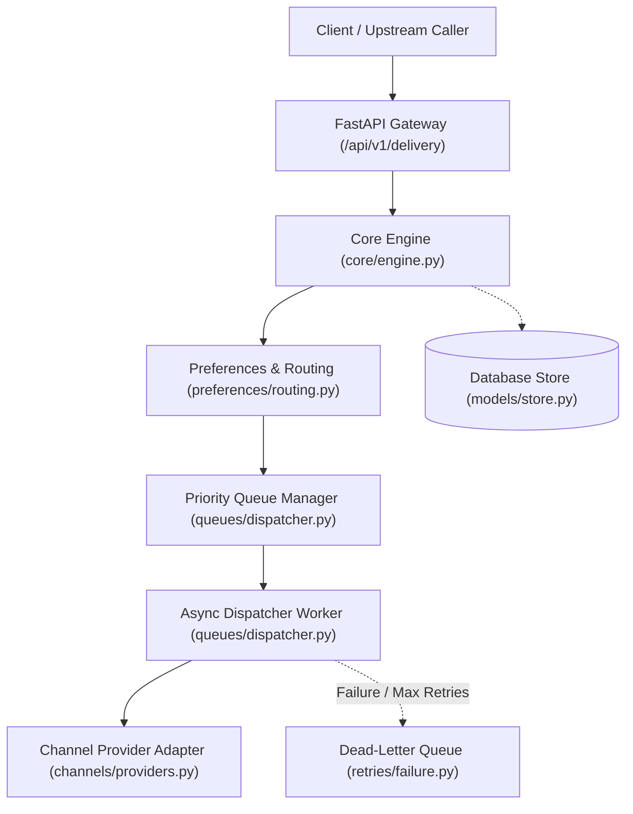
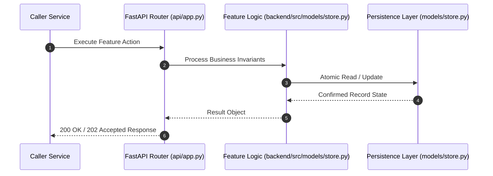

# F4: Delivery Attempt Store & Latency Auditing (NTF-004)

## 1. Technical Summary & Behavior
Granular ledger recording every provider interaction, external transaction IDs, response latencies, and error codes.

- **Feature ID**: `F4`
- **Source Files**: `backend/src/models/store.py`
- **Key Implementation Lines**: `store.py:201-230 (DeliveryAttemptRecord), store.py:603-635 (record_delivery_attempt)`
- **Data & Schema**: `delivery_attempts (id, notification_id, provider_id, status, error_code, error_message, latency_ms, attempted_at)`

---

## 2. Architecture & Data Flow



---

## 3. Sequence Flow Diagram



---

## 4. Failure Path & Resilience Diagram

```mermaid
flowchart LR
    Start["Initiate Operation"] --> CheckInvariant Valid?
    Check -->|Yes| Exec["Execute State Transition"]
    Check -->|No| Reject["422 / 400 Validation Error"]
    Exec --> DBCheckDB / Provider Success?
    DBCheck -->|Success| Complete["Monotonic State Complete"]
    DBCheck -->|Transient Error| Retry["Exponential Backoff with Full Jitter"]
    DBCheck -->|Permanent Error / Cap| DeadLetter["Route to DLQ & Log Audit Event"]
```

---

## 5. Security & Edge Case Considerations

- **Tenant Isolation**: Every query and operation scopes explicitly to `tenant_id`. Cross-tenant data leakage is structurally prevented.
- **Data Sanitization & Encryption**: Sensitive recipient tokens and provider secrets are encrypted with Fernet and masked on all outputs.
- **Idempotency**: Requests enforce unique constraint hashes to prevent duplicate dispatch under network retries.

---

## 6. Say It Out Loud (Spoken Interview Script)

> "I implemented the delivery attempt store to provide a forensic audit trail of every network call made to third-party providers. Every time an email, SMS, or webhook adapter sends a message, it records the exact provider ID, execution latency in milliseconds, outcome status, and upstream error message. I used a foreign key to the parent notification record with indexing on notification_id and provider_id. If a database write fails here, it is caught in a fallback block so the delivery itself is not aborted. The main limitation is rapid table growth, which I would solve with table partitioning and automated cold-storage archiving."
