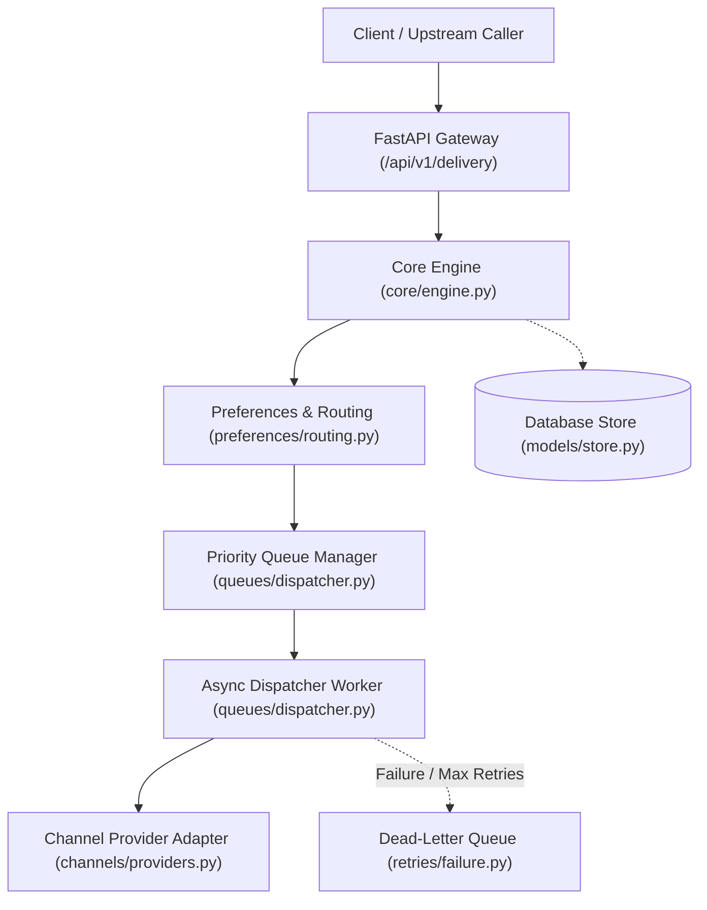
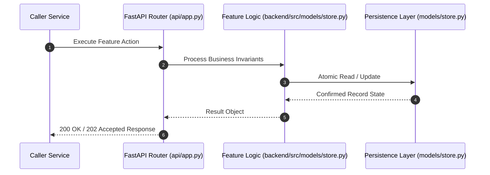

# F5: Provider Configuration Store & Encryption (NTF-005, NTF-010, NTF-049)

## 1. Technical Summary & Behavior
Encrypted configuration store for third-party provider credentials, priorities, and rate limits.

- **Feature ID**: `F5`
- **Source Files**: `backend/src/models/store.py`, `backend/src/channels/credentials.py`
- **Key Implementation Lines**: `store.py:236-268 (ProviderConfigRecord), channels/credentials.py:18-80 (ProviderCredentialManager)`
- **Data & Schema**: `provider_configs (id, tenant_id, channel, provider_name, credentials_json, priority, rate_limit_rps, is_active, created_at)`

---

## 2. Architecture & Data Flow



---

## 3. Sequence Flow Diagram



---

## 4. Failure Path & Resilience Diagram

```mermaid
flowchart LR
    Start["Initiate Operation"] --> CheckInvariant Valid?
    Check -->|Yes| Exec["Execute State Transition"]
    Check -->|No| Reject["422 / 400 Validation Error"]
    Exec --> DBCheckDB / Provider Success?
    DBCheck -->|Success| Complete["Monotonic State Complete"]
    DBCheck -->|Transient Error| Retry["Exponential Backoff with Full Jitter"]
    DBCheck -->|Permanent Error / Cap| DeadLetter["Route to DLQ & Log Audit Event"]
```

---

## 5. Security & Edge Case Considerations

- **Tenant Isolation**: Every query and operation scopes explicitly to `tenant_id`. Cross-tenant data leakage is structurally prevented.
- **Data Sanitization & Encryption**: Sensitive recipient tokens and provider secrets are encrypted with Fernet and masked on all outputs.
- **Idempotency**: Requests enforce unique constraint hashes to prevent duplicate dispatch under network retries.

---

## 6. Say It Out Loud (Spoken Interview Script)

> "I built the provider configuration store to decouple upstream vendor integrations from application code. Tenant administrators can register multiple providers per channel, defining their priority rank and requests-per-second limits. In `backend/src/channels/credentials.py`, all sensitive credentials like SendGrid API keys and Twilio tokens are encrypted at rest using AES-128 via Fernet and masked on all API outputs and console logs. I chose symmetric encryption over external KMS for local portability while providing a clean abstraction for AWS KMS or HashiCorp Vault. If decryption fails due to key mismatch, the engine flags the provider as unhealthy and triggers an alert. In the future, I would integrate automated secret rotation hooks."
