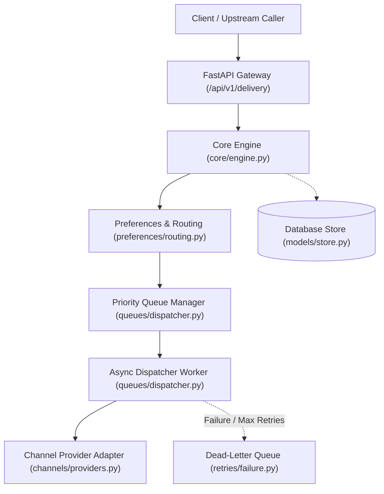
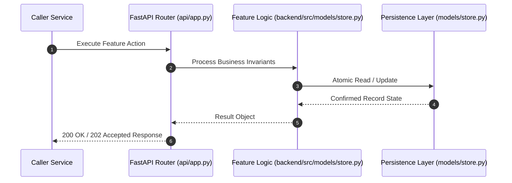

# F6: Scheduled Job Store & Delayed Triggers (NTF-006, NTF-011, NTF-058, NTF-059)

## 1. Technical Summary & Behavior
Persistent store and poller for future-dated notifications, automated onboarding sequences, and reminder alerts.

- **Feature ID**: `F6`
- **Source Files**: `backend/src/models/store.py`, `backend/src/queues/dispatcher.py`
- **Key Implementation Lines**: `store.py:273-302 (ScheduledJobRecord), queues/dispatcher.py:96-126 (ScheduledQueueManager)`
- **Data & Schema**: `scheduled_jobs (job_id, notification_id, tenant_id, run_at, status, created_at)`

---

## 2. Architecture & Data Flow



---

## 3. Sequence Flow Diagram



---

## 4. Failure Path & Resilience Diagram

```mermaid
flowchart LR
    Start["Initiate Operation"] --> CheckInvariant Valid?
    Check -->|Yes| Exec["Execute State Transition"]
    Check -->|No| Reject["422 / 400 Validation Error"]
    Exec --> DBCheckDB / Provider Success?
    DBCheck -->|Success| Complete["Monotonic State Complete"]
    DBCheck -->|Transient Error| Retry["Exponential Backoff with Full Jitter"]
    DBCheck -->|Permanent Error / Cap| DeadLetter["Route to DLQ & Log Audit Event"]
```

---

## 5. Security & Edge Case Considerations

- **Tenant Isolation**: Every query and operation scopes explicitly to `tenant_id`. Cross-tenant data leakage is structurally prevented.
- **Data Sanitization & Encryption**: Sensitive recipient tokens and provider secrets are encrypted with Fernet and masked on all outputs.
- **Idempotency**: Requests enforce unique constraint hashes to prevent duplicate dispatch under network retries.

---

## 6. Say It Out Loud (Spoken Interview Script)

> "I implemented the scheduled job engine to handle delayed notifications, such as appointment reminders and onboarding drip campaigns. When a payload arrives with a `scheduled_for` timestamp, the system persists a `ScheduledJobRecord` with an indexed `run_at` timestamp. In `backend/src/queues/dispatcher.py`, the `ScheduledQueueManager` periodically polls for jobs where `run_at <= now` and status is PENDING, atomically marking them EXECUTED and pushing the parent notification into the priority queue. I rejected external cron systems like Celery Beat or Quartz to keep the infrastructure lightweight and self-contained within our async database engine. If a polling cycle fails, un-executed jobs remain pending and fire on the next pass without loss. To scale this past 10,000 scheduled jobs per minute, I would migrate the index to Redis Sorted Sets using timestamps as scores."
