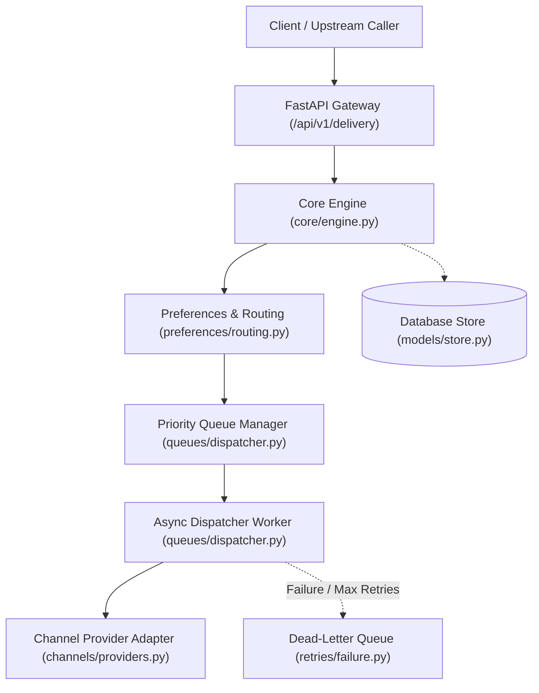
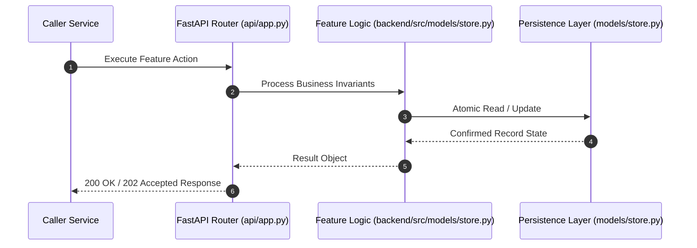

# F7: Queue State Store & Lease-Based Locking (NTF-007, NTF-056, NTF-057)

## 1. Technical Summary & Behavior
State store powering atomic dequeueing, lease-based locking, starvation protection, and duplicate prevention.

- **Feature ID**: `F7`
- **Source Files**: `backend/src/models/store.py`, `backend/src/queues/dispatcher.py`
- **Key Implementation Lines**: `store.py:307-332 (QueueStateRecord), store.py:856-940 (dequeue_item), queues/dispatcher.py:51-95 (PriorityQueueManager)`
- **Data & Schema**: `queue_state (item_id, queue_name, priority, payload_json, lock_token, locked_until, enqueued_at)`

---

## 2. Architecture & Data Flow



---

## 3. Sequence Flow Diagram



---

## 4. Failure Path & Resilience Diagram

```mermaid
flowchart LR
    Start["Initiate Operation"] --> CheckInvariant Valid?
    Check -->|Yes| Exec["Execute State Transition"]
    Check -->|No| Reject["422 / 400 Validation Error"]
    Exec --> DBCheckDB / Provider Success?
    DBCheck -->|Success| Complete["Monotonic State Complete"]
    DBCheck -->|Transient Error| Retry["Exponential Backoff with Full Jitter"]
    DBCheck -->|Permanent Error / Cap| DeadLetter["Route to DLQ & Log Audit Event"]
```

---

## 5. Security & Edge Case Considerations

- **Tenant Isolation**: Every query and operation scopes explicitly to `tenant_id`. Cross-tenant data leakage is structurally prevented.
- **Data Sanitization & Encryption**: Sensitive recipient tokens and provider secrets are encrypted with Fernet and masked on all outputs.
- **Idempotency**: Requests enforce unique constraint hashes to prevent duplicate dispatch under network retries.

---

## 6. Say It Out Loud (Spoken Interview Script)

> "I designed the queue state engine to provide robust, lease-based distributed queueing directly backed by our database. In `backend/src/models/store.py`, each enqueued notification has a priority weight, payload, and lease fields: `lock_token` and `locked_until`. When a worker calls `dequeue_item`, it executes an atomic query that orders by priority descending and enqueued timestamp ascending, filtering for unlocked or expired leases. If a worker crashes mid-delivery, its lease expires after 30 seconds, allowing a peer worker to reclaim the job automatically without message loss. To prevent low-priority notifications from starving when high-priority bursts occur, I built an optional starvation threshold that prioritizes aged jobs regardless of their priority level. I chose lease locking over Redis BLPOP because it guarantees message survivability and persistence across restarts without requiring Redis cluster replication. If concurrent workers attempt to claim the same row, database transaction isolation and atomic update statements ensure exactly one worker wins. A limitation of database queues is disk I/O lock contention at high concurrency, which is why at enterprise scale I would back this with Apache Kafka or Amazon SQS."
