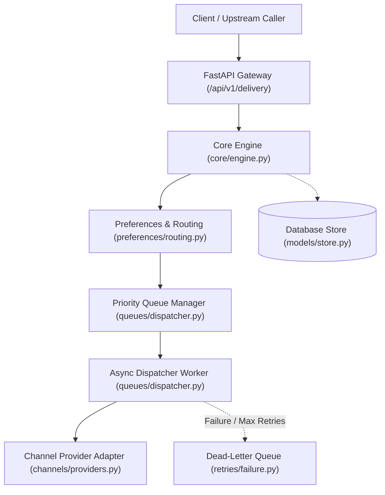
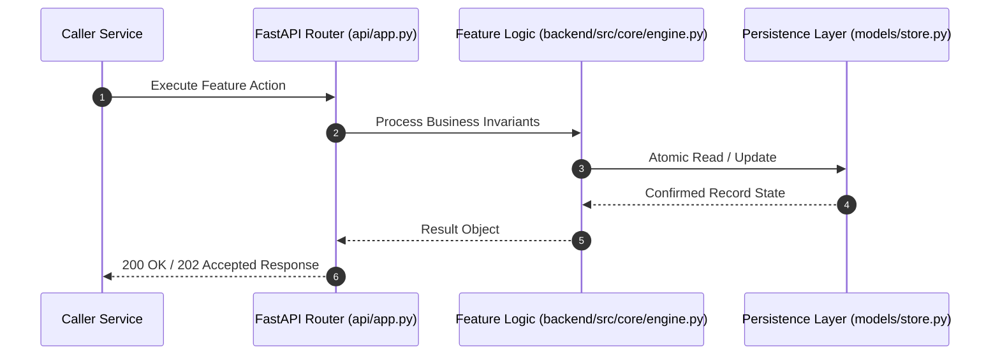

# F8: Ingestion Engine, Schema Validation & Request Idempotency (NTF-014, NTF-015, NTF-016, NTF-018, NTF-019)

## 1. Technical Summary & Behavior
Front-door ingestion pipeline validating E.164 phone numbers, RFC-5322 emails, URLs, and enforcing idempotency keys.

- **Feature ID**: `F8`
- **Source Files**: `backend/src/core/engine.py`
- **Key Implementation Lines**: `core/engine.py:50-90 (NotificationRequestPayload), core/engine.py:100-163 (NotificationCoreEngine.ingest_request)`
- **Data & Schema**: `IngestionResult (notification_id, status, priority_weight, is_duplicate, recipient_normalized)`

---

## 2. Architecture & Data Flow



---

## 3. Sequence Flow Diagram



---

## 4. Failure Path & Resilience Diagram

```mermaid
flowchart LR
    Start["Initiate Operation"] --> CheckInvariant Valid?
    Check -->|Yes| Exec["Execute State Transition"]
    Check -->|No| Reject["422 / 400 Validation Error"]
    Exec --> DBCheckDB / Provider Success?
    DBCheck -->|Success| Complete["Monotonic State Complete"]
    DBCheck -->|Transient Error| Retry["Exponential Backoff with Full Jitter"]
    DBCheck -->|Permanent Error / Cap| DeadLetter["Route to DLQ & Log Audit Event"]
```

---

## 5. Security & Edge Case Considerations

- **Tenant Isolation**: Every query and operation scopes explicitly to `tenant_id`. Cross-tenant data leakage is structurally prevented.
- **Data Sanitization & Encryption**: Sensitive recipient tokens and provider secrets are encrypted with Fernet and masked on all outputs.
- **Idempotency**: Requests enforce unique constraint hashes to prevent duplicate dispatch under network retries.

---

## 6. Say It Out Loud (Spoken Interview Script)

> "I built the request ingestion pipeline in `backend/src/core/engine.py` to act as the strict gatekeeper for the entire messaging platform. Using Pydantic v2, every incoming payload is validated: email addresses are checked against RFC patterns, phone numbers are stripped of delimiters and normalized into E.164 international format, and webhook targets are validated as HTTP/HTTPS URLs. Next, the engine generates a globally unique notification ID prefixed with `ntf_` and queries the database for an existing record matching `tenant_id` and `idempotency_key`. If a matching key is found, the engine immediately returns the existing notification status and ID with `is_duplicate=True`, completely bypassing redundant downstream provider calls. I chose application-level idempotency paired with database unique constraints to eliminate duplicate billing and prevent users from receiving multiple OTP codes. If validation fails, the API responds with a structured 422 error detailing the invalid field. One limitation is that idempotency keys are retained indefinitely; in a massive production environment, I would add a TTL pruning job to archive idempotency keys older than 30 days."
