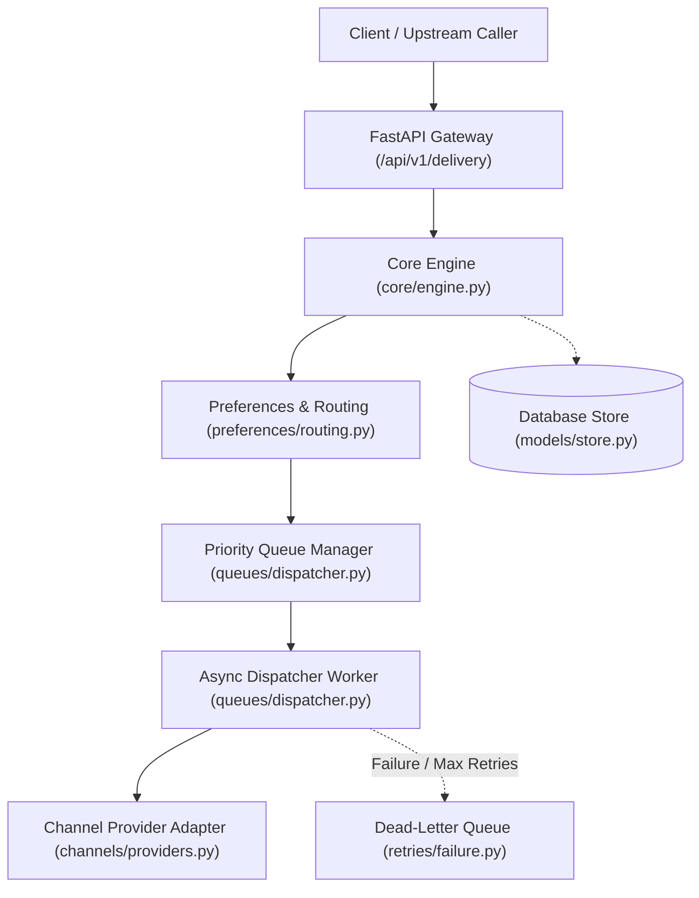
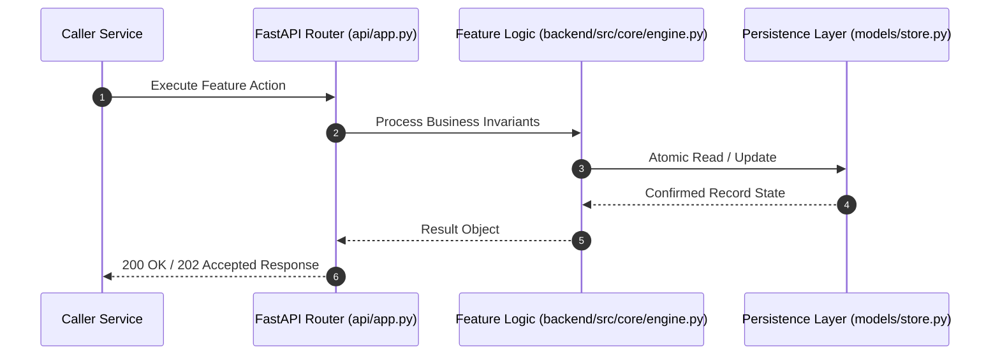

# F9: Monotonic State Machine & Priority Preemption (NTF-020, NTF-021)

## 1. Technical Summary & Behavior
Finite state machine enforcing legal status transitions and mapping priorities to numerical weights.

- **Feature ID**: `F9`
- **Source Files**: `backend/src/core/engine.py`
- **Key Implementation Lines**: `core/engine.py:31-47 (PRIORITY_WEIGHTS, VALID_TRANSITIONS), core/engine.py:164-188 (transition_state)`
- **Data & Schema**: `States: PENDING -> QUEUED -> DISPATCHING -> DELIVERED | FAILED | SUPPRESSED`

---

## 2. Architecture & Data Flow



---

## 3. Sequence Flow Diagram



---

## 4. Failure Path & Resilience Diagram

```mermaid
flowchart LR
    Start["Initiate Operation"] --> CheckInvariant Valid?
    Check -->|Yes| Exec["Execute State Transition"]
    Check -->|No| Reject["422 / 400 Validation Error"]
    Exec --> DBCheckDB / Provider Success?
    DBCheck -->|Success| Complete["Monotonic State Complete"]
    DBCheck -->|Transient Error| Retry["Exponential Backoff with Full Jitter"]
    DBCheck -->|Permanent Error / Cap| DeadLetter["Route to DLQ & Log Audit Event"]
```

---

## 5. Security & Edge Case Considerations

- **Tenant Isolation**: Every query and operation scopes explicitly to `tenant_id`. Cross-tenant data leakage is structurally prevented.
- **Data Sanitization & Encryption**: Sensitive recipient tokens and provider secrets are encrypted with Fernet and masked on all outputs.
- **Idempotency**: Requests enforce unique constraint hashes to prevent duplicate dispatch under network retries.

---

## 6. Say It Out Loud (Spoken Interview Script)

> "I designed the notification state machine to guarantee that delivery status transitions are strictly monotonic and auditable. The allowable lifecycle moves from PENDING to QUEUED, then DISPATCHING, and terminates in DELIVERED, SUPPRESSED, or FAILED. Any illegal transition—such as moving backwards from DELIVERED to QUEUED—is caught and rejected with an explicit error. Alongside the state machine, I implemented priority weighting: URGENT maps to 100, HIGH to 50, NORMAL to 10, and LOW to 0. When workers drain the queue, high-priority jobs naturally preempt bulk newsletters. I chose a formal dictionary-driven transition map over ad-hoc status assignments to prevent race conditions during concurrent retries. A limitation is that state changes are synchronous database updates; at higher scales, I would broadcast state events over an event bus like Kafka."
