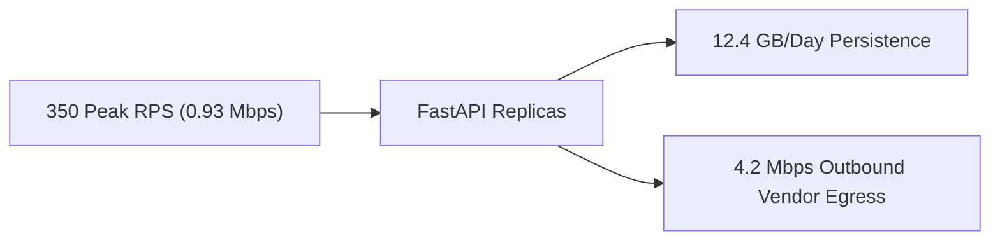

# 14.1 Requirements & Capacity Estimation

## 1. Functional & Non-Functional Requirements

### Functional Requirements
- Ingest notification requests across 5 channels (Email, SMS, Webhook, Push, In-App).
- Enforce strict idempotency via client-provided keys to guarantee no duplicate deliveries.
- Schedule delayed jobs for future dispatch (`run_at`).
- Support multi-tier priority scheduling: URGENT, HIGH, NORMAL, LOW.
- Enforce user preferences, category opt-outs, and timezone-aware quiet hours.
- Provide resilience through exponential backoff retries, provider fallback, and dead-letter queue (DLQ) replay.

### Non-Functional Requirements
- **High Availability**: 99.95% uptime for the ingestion API.
- **Low Latency**: Sub-second dispatch for URGENT (OTP) alerts; p99 API ingress < 50ms.
- **Durability**: Zero message loss once acknowledged with HTTP 202.
- **Auditability**: Complete forensic trace of all delivery attempts and administrative actions.

---

## 2. Capacity Estimation (10 Million Notifications / Day)

Let us calculate capacity for a production scale of **10,000,000 notifications per day**.

### Request Throughput (RPS)
$$\text{Average RPS} = \frac{10,000,000 \text{ messages}}{86,400 \text{ seconds}} \approx 116 \text{ requests/sec}$$
$$\text{Peak RPS (3x multiplier)} = 116 \times 3 \approx 350 \text{ requests/sec}$$
$$\text{Marketing Blast Spike (10x)} \approx 1,200 \text{ requests/sec}$$

### Storage Calculations
- Average payload size (recipient, subject, body, metadata): **1 KB**
- Daily storage for notifications:
$$10,000,000 \times 1 \text{ KB} = 10,000,000 \text{ KB} \approx 10 \text{ GB/day}$$
- Delivery attempt records (avg 1.2 attempts per message @ 200 bytes):
$$10,000,000 \times 1.2 \times 200 \text{ bytes} \approx 2.4 \text{ GB/day}$$
- Total storage growth per year:
$$(10 \text{ GB} + 2.4 \text{ GB}) \times 365 \approx 4.5 \text{ TB/year}$$

### Bandwidth Calculations
- Ingress bandwidth (avg 116 req/sec @ 1 KB):
$$116 \times 1 \text{ KB} \approx 116 \text{ KB/sec} \approx 0.93 \text{ Mbps}$$
- Peak egress bandwidth (350 req/sec @ 1.5 KB payload to SendGrid/Twilio):
$$350 \times 1.5 \text{ KB} \approx 525 \text{ KB/sec} \approx 4.2 \text{ Mbps}$$

---

## 3. Say It Out Loud
> "For our capacity planning, I modeled the platform for 10 million notifications daily, which translates to an average throughput of 116 requests per second with marketing blast spikes reaching 1,200 RPS. At an average payload size of one kilobyte, the platform accumulates approximately 12.4 gigabytes of data daily across notifications and delivery attempt ledgers, totaling about 4.5 terabytes annually. Our network egress bandwidth peaks at roughly 4.2 megabits per second. To prevent database exhaustion at this volume, our architecture uses database table partitioning with automated 90-day cold-storage archiving."
