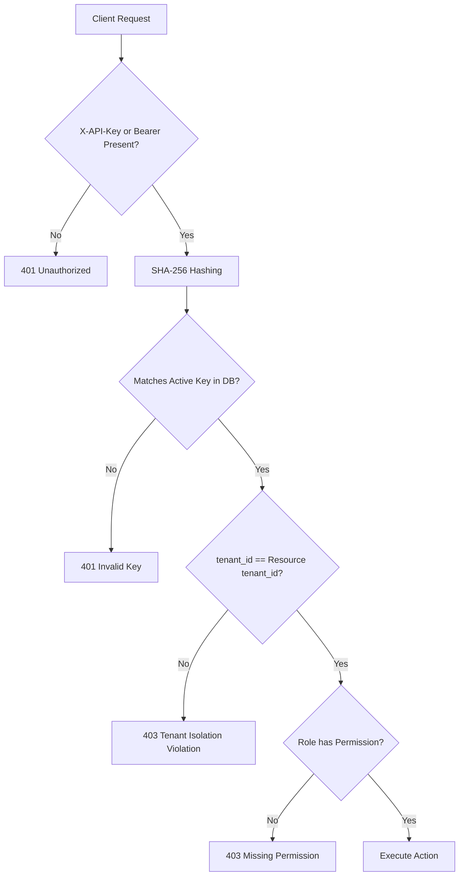

# 14.11 Security Architecture & Zero-Trust RBAC

## 1. Access Control Matrix & Key Hashing

## 2. Say It Out Loud
> "Our security architecture enforces zero trust across three layers: first, raw API keys are never stored in plaintext; they are hashed with SHA-256 upon issuance. Second, our deny-by-default RBAC model restricts destructive operations like DLQ redrives to ADMIN and OPERATOR roles. Third, adversarial tenant verification guarantees that even authenticated users from Tenant A cannot access Tenant B's delivery records."
