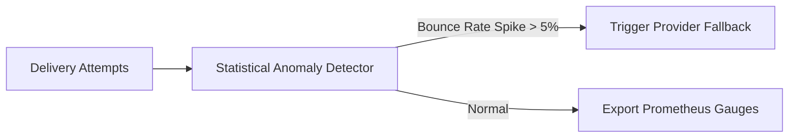

# 14.12 Search, AI & Delivery Anomaly Detection

## 1. Architecture Overview
OmniPost incorporates predictive delivery send-time optimization and automated anomaly detection to optimize open rates and flag vendor blacklisting.

## 2. Say It Out Loud
> "We utilize pre-trained APIs and statistical telemetry to detect delivery anomalies in real time. If a provider's bounce rate suddenly exceeds five percent—indicating potential carrier IP blacklisting or DNS issues—the anomaly detector automatically trips our provider fallback logic and fires alerts to our on-call engineers."
