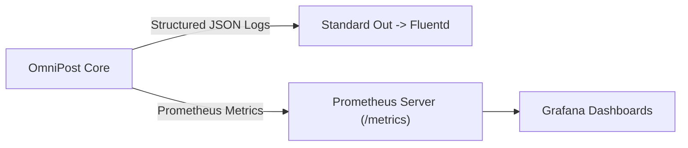

# 14.14 Observability, Prometheus & Operations

## 1. Telemetry Metrics & Structured Logging

### Key Exported Metrics
- `notification_delivery_success_total{channel, provider}`: Counter of successful deliveries.
- `notification_delivery_failure_total{channel, provider, error_code}`: Counter of failed attempts.
- `notification_delivery_latency_ms{quantile="0.95"}`: p95 execution latency across providers.

## 2. Say It Out Loud
> "Our observability system is built on Prometheus metrics and structured JSON logging. In `observability/metrics.py`, we track p50 and p95 latency percentiles, failure counts by error code, and delivery rates across every provider and channel. Structured JSON logs include request IDs and tenant IDs, enabling rapid filtering in Datadog or Grafana during production incidents."
