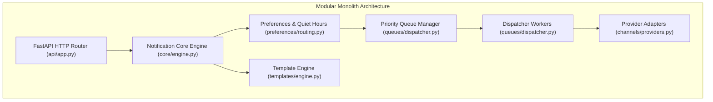

# 14.2 Architecture Styles & Decoupled Workers

## 1. What It Is & Project Architecture
OmniPost is structured as a **modular monolith** with decoupled asynchronous background workers communicating over database queue state ledgers.

## 2. Monolith vs Microservices Comparison

| Factor | Modular Monolith (Chosen) | Microservices | Serverless (AWS Lambda) |
| :--- | :--- | :--- | :--- |
| **Operational Overhead** | **Low (single deployable unit)** | High (Kubernetes, service mesh) | Moderate (CloudWatch, IAM) |
| **Network Latency** | **Microseconds (in-process calls)**| Milliseconds (HTTP/gRPC hops) | Variable (Cold starts 200-800ms) |
| **Data Consistency** | **ACID database transactions** | Eventual consistency / 2PC | Eventual consistency |
| **Deployment Complexity** | **Zero distributed tracing setup**| High (OpenTelemetry, Istio) | High (SAM / Serverless framework)|

- **Why Modular Monolith**: In early and growth stages, microservices introduce severe network serialization latency, distributed transaction complexity, and massive DevOps overhead. A modular monolith provides clean domain boundaries in code while allowing atomic transactions.
- **When to Split**: When deployment velocity between the template editing team and the high-throughput delivery dispatcher team causes release conflicts.

## 3. Say It Out Loud
> "I architected OmniPost as a clean modular monolith rather than microservices to avoid distributed transaction overhead and network latency. The domain boundaries—ingestion, template personalization, preference routing, and worker dispatching—are completely isolated in separate Python packages with clear public interfaces. This design allows us to run workers in the same process during local development while enabling us to deploy dedicated worker containers in production simply by changing the entrypoint command."
