# 14.3 Networking & Communication Protocols

## 1. Request Path & Protocols

```mermaid
flowchart LR
    Client["Client Service"] -->|HTTPS / HTTP/2| ALB["Application Load Balancer"]
    ALB -->|Reverse Proxy| Uvicorn["Uvicorn ASGI (Port 8200)"]
    Uvicorn -->|FastAPI Pipeline| Router["Route Handler"]
    Router -->|Async HTTP Post| Vendor["SendGrid / Twilio API"]
    Vendor -->|Inbound Webhook Receipt| WebhookHandler["Delivery Receipt Webhook"]
```

## 2. Protocols Comparison

| Protocol | Usage in OmniPost | Latency | Overhead | Fit for Messaging |
| :--- | :--- | :--- | :--- | :--- |
| **HTTP/2 (REST)** | **Primary API Ingestion** | Low | Low (Multiplexed) | Standard microservice ingress |
| **Webhooks (HMAC)** | **Inbound & Outbound Push** | Medium | Low | Partner notifications |
| **WebSockets** | Operations Console (Roadmap) | Lowest | High connection state | Real-time dashboards |
| **gRPC (Protobuf)** | Internal Service Mesh (Roadmap)| Ultra-Low | Lowest (Binary) | High-throughput ingress |

## 3. Say It Out Loud
> "For networking, OmniPost uses HTTP/2 over TLS for ingress, taking advantage of multiplexed TCP connections to reduce connection handshake overhead. For outbound webhook delivery, we sign every payload with an HMAC-SHA256 signature in the `X-Signature-SHA256` header, timestamping the request to prevent replay attacks. Upstream provider delivery receipts are received via inbound webhook endpoints that transition delivery attempt records from DISPATCHING to DELIVERED."
