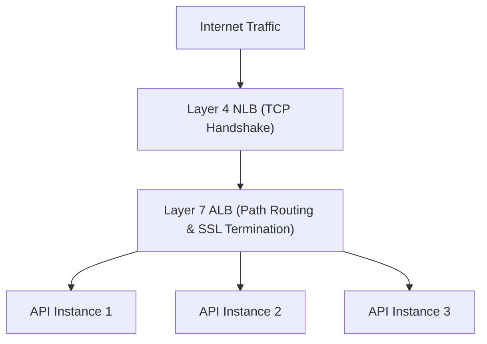

# 14.4 Load Balancing & Scaling Strategy

## 1. Load Balancing Algorithms & Layer 4 vs Layer 7

| Dimension | Layer 4 (Network Load Balancer) | Layer 7 (Application Load Balancer - Chosen) |
| :--- | :--- | :--- |
| **OSI Layer** | Transport (TCP/UDP) | Application (HTTP/HTTPS) |
| **Routing Capability** | IP and Port only | Path-based (`/api/v1/*`), header-based (`X-Tenant-ID`) |
| **TLS Termination** | Pass-through or TCP-level | Native SSL/TLS offloading |
| **Throughput** | Extreme (Millions req/s) | High (Tens of thousands req/s) |

- **Why Layer 7**: OmniPost routes administrative console traffic and API traffic to specific target groups while terminating TLS certificates at the edge.

## 2. Say It Out Loud
> "We employ a Layer 7 Application Load Balancer using a round-robin algorithm with least-outstanding-requests routing. Because our FastAPI nodes are completely stateless, any incoming request can be served by any node without sticky sessions. SSL termination occurs at the load balancer, offloading expensive cryptographic handshakes from application instances."
