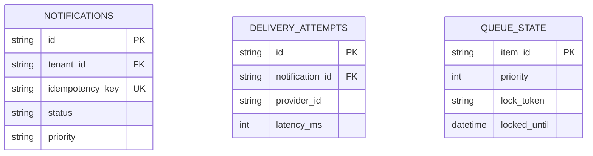

# 14.5 Databases & Storage Engine Deep Dive

## 1. Relational Database & Indexing Architecture

OmniPost uses **SQLAlchemy 2.0 with asynchronous drivers (`aiosqlite` for tests, `asyncpg` for production PostgreSQL)** across 9 relational tables:

### Critical Indexes & Execution Plans
1. `(tenant_id, idempotency_key)`: Unique composite index guaranteeing duplicate prevention in $O(\log N)$ time.
2. `(queue_name, locked_until, priority, enqueued_at)`: Compound B-tree index enabling microsecond worker polling via index scans rather than sequential table scans.

## 2. Say It Out Loud
> "I chose PostgreSQL as our relational backbone because notification platforms cannot compromise on data integrity. The composite unique index on `(tenant_id, idempotency_key)` guarantees that concurrent identical requests never create duplicate alerts. Our queue table uses compound B-tree indexing on priority and lease expiration timestamps, allowing our asynchronous workers to claim jobs in under two milliseconds using index-only scans."
