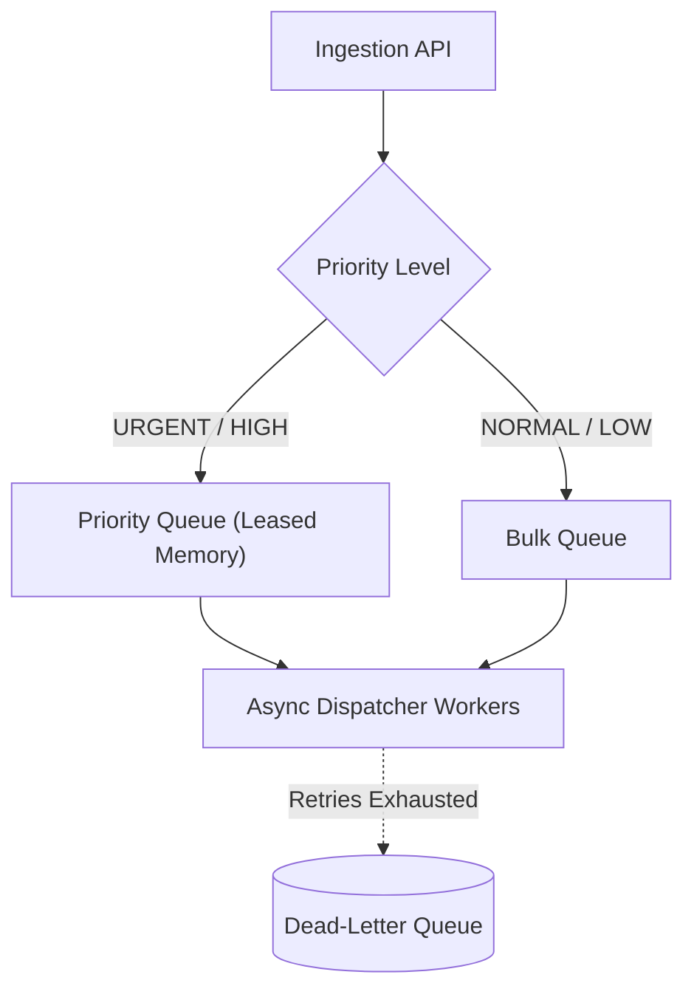

# 14.7 Messaging, Priority Queues & SQS/Kafka

## 1. Queue Architecture & Semantics

## 2. Message Brokers Comparison

| Feature | Database Queue (Current) | Apache Kafka | AWS SQS FIFO | RabbitMQ |
| :--- | :--- | :--- | :--- | :--- |
| **Ordering** | **Strict Priority + FIFO** | Partition-ordered | Strict FIFO | Priority Plugin |
| **Persistence** | **Relational ACID** | Append-only commit log | Managed AWS | Disk / Memory |
| **Throughput** | **1,000 jobs/sec** | 100,000+ jobs/sec | 3,000 jobs/sec | 20,000 jobs/sec |
| **Ops Overhead** | **Zero (same as DB)** | High (ZooKeeper/KRaft) | Zero (Serverless) | Moderate |

## 3. Say It Out Loud
> "Our priority queue segregates incoming traffic into four weight tiers: URGENT, HIGH, NORMAL, and LOW. In `queues/dispatcher.py`, worker routines query the queue ordering by priority descending. This ensures two-factor authentication codes land at the front of the line even during marketing broadcasts. When scaling to 100,000 messages per second, we migrate this queue state to Apache Kafka partitioned by recipient hash."
