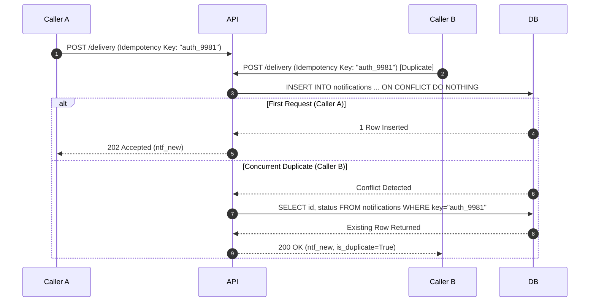

# 14.8 Consistency, Concurrency & Idempotency

## 1. Concurrency Model & Idempotent Mechanics

## 2. Say It Out Loud
> "We solve concurrency and duplicate delivery challenges by combining application idempotency keys with database-level unique constraints. When upstream services retry network calls after timeouts, our unique index on `(tenant_id, idempotency_key)` catches duplicate requests at the database boundary, returning the existing notification record without re-triggering provider dispatch."
