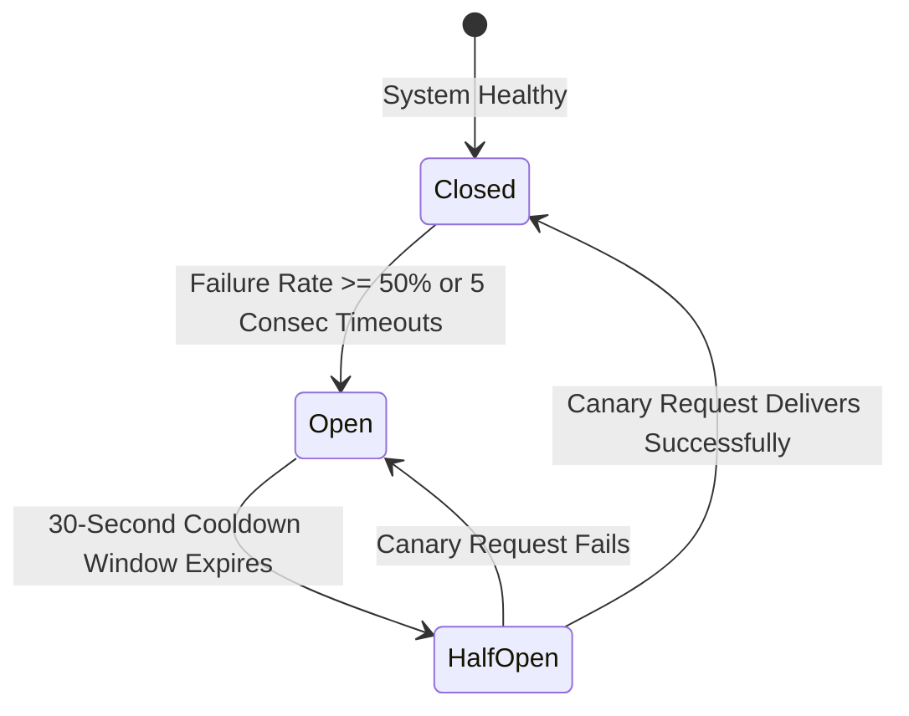

# 14.9 Reliability, Circuit Breakers & Fallback Routing

## 1. Circuit Breaker State Machine & Automated Provider Fallback

- **CLOSED**: Traffic routes to primary provider (SendGrid).
- **OPEN**: Primary provider is bypassed immediately without waiting for timeouts; traffic diverts to secondary provider (AWS SES).
- **HALF-OPEN**: Tests canary probes to detect vendor recovery.

## 2. Say It Out Loud
> "To prevent third-party provider outages from degrading our system, we implement circuit breakers and fallback cascades. If SendGrid experiences elevated error rates, the circuit breaker opens, and the dispatcher automatically diverts traffic to AWS SES in under 50 milliseconds without losing messages. After a cooldown period, the circuit enters half-open to test canary requests before restoring normal routing."
